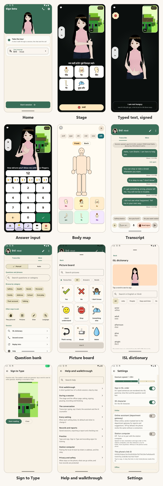

# Sign Setu

An offline Android app that helps a police officer communicate with a person who cannot communicate in words: deaf, non-verbal, traumatised or speaking another language. A 3D character signs and gestures, pictures and captions carry the question, typed text is played in draft Indian Sign Language order, and signed answers are read on the phone inside explicit sign windows. The app is a communication aid, not an interpreter, and not the statutory recording of a statement; it records the person's voice only with logged consent, between the officer's tap to start and tap to stop.

- Version 0.8.4.iroh (version code 21). Android 10 (API 29) and later, 64-bit; Kotlin and Jetpack Compose; one `app` module.
- Works fully offline. Online services are opt-in: the department gateway (enrolled with a one-time department code) or a custom OpenAI- or Anthropic-compatible endpoint, used only while the officer has the online assistant on; and the optional station computer, reached only once a phone is paired with it in Settings. No assistant key is compiled into an APK.
- Permissions: `RECORD_AUDIO` records the person's own speech only, with consent logged first. No location or scanning permission in the `standard` flavor; every build fails if a forbidden permission reaches the merged manifest.
- Sessions live in an encrypted SQLCipher database under a Keystore key that works only while the phone is unlocked. A finished session is saved under a name the officer types. Every session is deleted 24 hours after its last activity by default, by an hourly background job even if the app is never opened; the officer can pick 4 to 72 hours or keep sessions until deleted.
- Optional on-device assistant: Gemma 3 1B Q4_K_M GGUF (about 806 MB, [Hugging Face](https://huggingface.co/ggml-org/gemma-3-1b-it-GGUF/resolve/main/gemma-3-1b-it-Q4_K_M.gguf)), handed out by the department as a file; Settings imports it and keeps it only if its SHA-256 is on the allow-list. The app never downloads it.

## Screenshots

Every screen is in [docs/12-screens.md](docs/12-screens.md).

## What it does

- **Stage for the person:** a 3D character (or a drawn one, chosen in Settings or used by itself where 3D cannot run; a department Rive file can replace both) signs questions in draft ISL order (recorded ISL signers for most words, recorded sentence clips where a typed sentence matches one), with pictures, captions in 17 languages and recorded speech. Answers come by tap, picture, writing, drawing, nod or shake, finger count, or signing to the camera. Water and food can be asked for at any moment and are logged as requests, not answers. The express board adds Urgent and Safety cards and a front and back body map that records exactly where the person touched. A pause brings guided breathing (in 4 s, hold 2 s, out 6 s) without words.
- **Sign reading:** MediaPipe hand, body and face landmarks feed small on-device readers. ISL: 314 words, single letters and digits, and spelled names; ASL (experimental): 250 words and fingerspelling. Raised hands open a sign window, which closes when the hands rest for 2 s, nothing is signed for 3 s, or 20 s pass. Guesses that answer the question on screen rank first. While the person signs, the officer sees the words read so far, the reader's live top 3 and letters committed by holding a handshape for 500 ms; a sign two readers disagree on, or a close call, is marked unclear. Camera frames arrive as YUV; luma motion wakes the tracker and judges blur, and the whole frame is tracked, hands first. A reading goes to the officer only and is never an answer until the person picks its meaning from pictures. Accuracy: [tools/ml/EVAL.md](tools/ml/EVAL.md).
- **Officer side:** two-way transcription, a question bank including a full ISL lesson sheet in Hindi and English, phrases, show-back, an ISL and an ASL dictionary, and Manual or Auto conversation. Back leaves a session for the start screen without ending it; with a second screen connected it asks first, because leaving drops the link.
- **Second screen:** a paired phone shows the stage over bonded Bluetooth, on typed, encrypted frames. On Android 12 and later the officer can find and pair the other phone from inside the app.
- **Station brain (optional):** a station computer (`brain/`), reached on the station network or from anywhere over iroh (see Station brain and relay below), turns the person's recorded speech into text and, where its translator covers the language, into the officer's language, as the app's reading; it also translates and sets sign order. The recording itself works without it. Without it the phone works alone.
- **AI counsellor:** with the online assistant on, it can talk with a frightened victim or witness on the stage; each line waits 2 s on the officer's screen, where the officer can send it at once, replace it or take over. It is never offered for an accused person or anyone in custody.
- **Records:** finished sessions are listed on the start screen, can be opened again, and export to a password-protected PDF with a hash chain, a Merkle root signed by a Keystore device key, a QR verification page and a draft BSA s.63 certificate. Settings, Records, Check a report verifies an exported PDF; `tools/security/verify_seal.py` does the same off the phone.
- **Help and walkthrough:** an in-app guide, in English and Hindi, for the whole call (stage, officer page, sign windows, pause, recording, second screen, finishing), every setting, records and reports, practice, the station computer and privacy. A guided tour opens from the first-run screen and the Start screen; the full topic list from Settings, Help; in-call help from the session menu, Help, and from More, Session. The same text is in [docs/19-walkthrough.md](docs/19-walkthrough.md).
- **Settings:** interpreter contact, security (pin the app, block screenshots, fingerprint), stage camera and signing speed, ISL word order, the two sign languages and their accuracy, the assistants, retention, and Appearance (device default, light or dark, a pure-black dark mode, and ten colour themes).
- **Type-to-Sign practice** (Settings, Practice) plays any Hindi or English sentence outside a session, with nothing recorded. **Sign to Type** (Settings, Practice) is the reverse: the person signs to the camera, words and held letters build a sentence in English and Hindi, each word's other guesses are a tap away, and the phone can say it aloud; nothing is logged or kept.

## Quick start

1. Install the signed APK from the [latest release](https://github.com/Yash-Awasthi/sign-setu-pvt/releases/latest): `sign-setu-<version>-arm64.apk` for phones, `-universal.apk` for tablets and emulators. Allow installs from the source first; a screen lock is strongly recommended.
2. Open the app, read the three first-run steps (or tap Take the tour) and unlock with the screen lock or fingerprint.
3. On the Start screen choose who you are helping, their role and language, then Start session. The phone now faces the person; hold the small handle in the stage corner for a third of a second to take it back.
4. Finish the session, name it, then Save or Export report. The report password is shown once.

Help is always in the app: Settings, Help, or the session menu, Help. The full text is in [docs/19-walkthrough.md](docs/19-walkthrough.md).

## Build and test

The build needs JDK 21, Android SDK 37, NDK `30.0.16248370` and CMake 4.1.2. Dependencies are pinned in `gradle/libs.versions.toml`, locked in `app/gradle.lockfile` and verified by `gradle/verification-metadata.xml`. Build from a checkout outside a OneDrive folder: Files On-Demand marks sources as reparse points, which Java reports as "not a regular file", and annotation processing then fails.

| Command | Result |
| --- | --- |
| `./gradlew assembleStandardDebug` | Debug APK |
| `./gradlew testStandardDebugUnitTest` | Unit tests (also `testNearbyDebugUnitTest`) |
| `./gradlew connectedStandardDebugAndroidTest` | Instrumented tests on an emulator or phone |
| `cd avatar && npm install && npx vp test` | Avatar module tests; `npx vp build` rebuilds `app/src/main/assets/avatar/avatar.js` |
| `cd portal && npm install && npx vp test` | Reviewer portal tests (needs `npm install` in `avatar/` first) |
| `cd gateway && go test ./...` | Department gateway tests |
| `cd brain && .\setup.ps1` (or `./setup.sh`), then `.\start.ps1` | Sets up and starts the station brain, and prints its pairing ticket ([brain/README.md](brain/README.md)) |
| `python brain/check.py https://<ip>:8000 <token> <pin>` | Station brain security and latency check |
| `python tools/content/build_content.py --manifest-only` | Rebuilds the content hash manifest; run after any content change |

`SignPipelineDeviceTest` runs real ISLRTC clips (`app/src/androidTest/assets/islrtc/`) through the camera pipeline. It must pass after any MediaPipe or protobuf update: MediaPipe 1.1.1 runs on `protobuf-javalite`, and the full runtime breaks the landmarker without failing a unit test. `LessonTest` and `LessonSigningAuditTest` pin the lesson sheet's wording and how each sentence is signed.

## Release

| Command | Output |
| --- | --- |
| `./gradlew assembleStandardRelease` | Universal APK, arm64-v8a and x86_64 |
| `./gradlew assembleStandardRelease -Pabi=arm64-v8a` | Phone APK |

Release builds use R8 with resource shrinking. `-PgatewayUrl=https://...` (or `gatewayUrl=` in `local.properties`) builds in the department gateway; `-PsecureScreen=true` turns Settings, Security, Block screenshots on by default. A green push to `master` makes CI sign both APKs with the release key from repository secrets and publish `v<versionName>`: a new version gets a new release, the same version has its APKs replaced. See [docs/README.md](docs/README.md), section 5.

## Architecture

The phone app is the only store of a session. Everything else is optional and sits beside it.

| Part | Role | Detail |
| --- | --- | --- |
| `app/` | Officer page, stage, session record, sign reading, export, second-screen link, in-app Help | [docs/02-architecture.md](docs/02-architecture.md), [docs/03-ux.md](docs/03-ux.md) |
| `avatar/` | The 3D character shown in a WebView | [docs/05-avatar-and-gestures.md](docs/05-avatar-and-gestures.md) |
| `brain/` | Station computer: speech to text, translation, sign order, local language model, inbox | [brain/README.md](brain/README.md), [docs/18-station.md](docs/18-station.md) |
| `relay/` | The department's iroh relay | [docs/16-relay.md](docs/16-relay.md) |
| `gateway/` | Department gateway for the online assistant and speech | [gateway/README.md](gateway/README.md) |
| `portal/` | Reviewer portal for content sign-off | [portal/README.md](portal/README.md) |
| `tools/` | Content, sign retargeting, model training and security tools | `tools/*/README.md` |

Inside `app/src/main/java/app/signsetu`:

| Package | Contents |
| --- | --- |
| `ui/` | Screens: `AppRoot` navigation, `start/`, `session/` (officer page and stage), `settings/`, `help/`, `avatar/`, `practice/` |
| `data/` | Encrypted session store, settings, content bundle, translation and lexicon |
| `net/` | Station link (`BrainClient`, `IrohBrain`, `Http`) and the token vault |
| `sign/`, `camera/` | Sign readers, the landmark tracker, gestures and the camera mirror |
| `gloss/` | From read signs to a checked sentence |
| `voice/` | Consented voice capture and playback |
| `pair/` | Bluetooth second-screen link and its encryption |
| `export/` | Report PDF, hash chain, seal and verifier |
| `assistant/` | On-device, gateway and custom-endpoint assistants |

## Station brain and relay

The station computer runs `brain/` on one machine. On the station network a phone reaches it over HTTPS with a token and a certificate pin. From anywhere it dials an iroh ticket: an end-to-end encrypted QUIC link, direct where possible and otherwise through the department's own relay, which forwards ciphertext it cannot read. No port is opened at the station.

- Set up: `cd brain && .\setup.ps1 -Asr small` (or `./setup.sh --asr small`), then `.\start.ps1` (or `./start.sh`). It prints the LAN address, token, certificate pin and iroh ticket, and keeps them in `pairing.txt` in the state folder.
- Relay: `-Relay`/`--relay https://relay.example.gov.in` points the brain at the department's relay and puts it in the ticket. Without it the brain uses no relay and no third-party service, so phones need a direct path. The phone uses the relay named in the ticket and has no relay setting. Set the relay up with `relay/setup.sh` or `relay/setup.ps1` ([docs/16-relay.md](docs/16-relay.md)).
- If iroh cannot start the brain serves the station network only; if the relay is down at start it logs a warning and carries on.
- Pair the phone: Settings, Station computer, enter the ticket and token, or the address, token and pin. A ticket pasted with line breaks is accepted. The phone keeps one iroh identity per install, encrypted under a Keystore key.
- Conversations sent from a phone are saved in the inbox: `--inbox`, or `Sign Setu` in Documents (OneDrive's Documents first).

## Documentation

All documents are indexed in [docs/README.md](docs/README.md).

| Document | Contents |
| --- | --- |
| [docs/19-walkthrough.md](docs/19-walkthrough.md) | Walkthrough: a session step by step, the call, the conversation, every setting, records, practice, station computer, privacy |
| [docs/11-product-overview.md](docs/11-product-overview.md) | Feature reference |
| [docs/12-screens.md](docs/12-screens.md) | Every screen with screenshots |
| [docs/02-architecture.md](docs/02-architecture.md) | Architecture, data model, keys, export |
| [docs/04-security.md](docs/04-security.md), [docs/13-dpia.md](docs/13-dpia.md) | Security controls and data protection assessment |
| [docs/16-relay.md](docs/16-relay.md), [docs/18-station.md](docs/18-station.md) | Relay and station |

## Links

| Resource | Link | Notes |
| --- | --- | --- |
| Android APKs | [Latest release](https://github.com/Yash-Awasthi/sign-setu-pvt/releases/latest) | Signed `sign-setu-<version>-arm64.apk` for phones and `sign-setu-<version>-universal.apk` (arm64 and x86_64) for tablets and emulators, with SHA-256 sums and an SBOM; both carry the department gateway |
| Department gateway | [signsetu-gateway.onrender.com](https://signsetu-gateway.onrender.com/healthz) | Go on Render, Neon PostgreSQL; the free tier sleeps, so the first call can take about 30 s |
| Reviewer portal | [signsetu-portal.pages.dev](https://signsetu-portal.pages.dev) | Every motion on the app's own character, for content sign-off; Cloudflare Pages |
| On-device model | [gemma-3-1b-it-Q4_K_M.gguf](https://huggingface.co/ggml-org/gemma-3-1b-it-GGUF/resolve/main/gemma-3-1b-it-Q4_K_M.gguf) | About 806 MB; Settings, Offline, Import model file |
| Documentation | [docs/README.md](docs/README.md) | Requirements, architecture, security, DPIA |

## Repository

| Path | Contents |
| --- | --- |
| `app/` | The Android app (`app.signsetu`; application ID `in.signsetu`), flavors `standard` and `nearby` (Play services) |
| `app/src/main/assets/content/` | Content bundle: questions, cards, motions, clips, vocabulary, audio, models, hash manifest |
| `avatar/` | The 3D character (TypeScript, three.js, three-vrm): keyframe rig, retargeting onto the VRM model, clip playback; built into `app/src/main/assets/avatar/` |
| `gateway/` | Department gateway (Go, PostgreSQL): device enrolment, assistant and speech proxies, administrator device and audit views ([README](gateway/README.md)) |
| `portal/` | Reviewer portal for content sign-off (Vite+, React, TypeScript); not shipped ([README](portal/README.md)) |
| `tools/content/` | Content bundle, audio and sign builders and checks |
| `tools/isl/` | Retargeting recorded ISL and ASL signers onto the character ([README](tools/isl/README.md)) |
| `tools/ml/` | Sign reader training, export and evaluation ([README](tools/ml/README.md), [EVAL](tools/ml/EVAL.md)) |
| `tools/text2isl/` | Recorded sentence clips ([README](tools/text2isl/README.md)) |
| `tools/security/` | CycloneDX SBOM of the release APK (`sbom.py`, needs Syft) and the offline report seal check (`verify_seal.py`) |
| `content/` | Source symbols for the picture cards |
| `brain/` | Optional local AI brain for a station computer (FastAPI, faster-whisper, IndicTrans2 and NLLB-200, Ollama): port 8000 on the station network, or an iroh ticket from anywhere ([README](brain/README.md)) |
| `render.yaml` | Render blueprint for the gateway |
| `docs/` | Requirements, architecture, security and data protection assessment ([index](docs/README.md)) |

## Licences

Third-party components, data sets and models, with their licences and how each is used, are listed in [docs/08-open-source.md](docs/08-open-source.md); the app lists the shipped ones in Settings, About, Open-source licences. Some are not freely redistributable (for example the character model and the NLLB-200 weights); that document says which need written approval before release.
