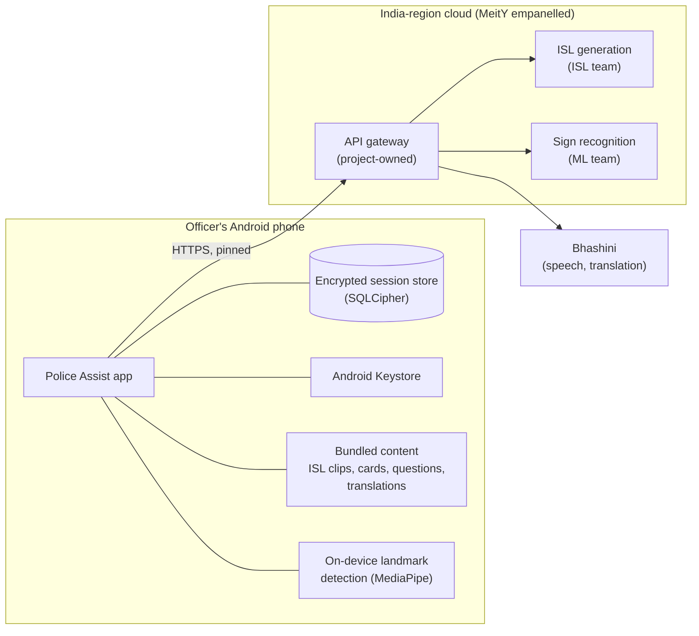

# 03. Architecture

## 1. Overview



The phone does everything that must work offline or touches raw images and video. The cloud does only what the phone cannot: generating ISL for arbitrary text, recognising signs from landmarks, speech recognition and translation. The app talks to one host only, the project's API gateway, which holds all partner credentials.

## 2. Architectural principles

1. **Offline core.** The triage flow, picture board, drawing and notes never need a network.
2. **Raw media stays on the phone.** Camera frames are reduced to landmark numbers on the phone; only those numbers are sent. Audio for speech recognition is the single exception and is sent only while the officer holds the record button.
3. **One trusted endpoint.** The app holds no partner API keys and talks only to the gateway (CERT-In 6.2.3).
4. **Small and boring.** One app module, few libraries, no frameworks that the size and audit budget cannot justify.
5. **Adapters at every boundary.** Each partner service sits behind an interface with a real and a fake implementation, so partner format changes touch one file.

## 3. Technology stack

| Layer | Choice | Reason |
| --- | --- | --- |
| Language | Kotlin | Native Android, first-class tooling |
| UI | Jetpack Compose, Material 3 | Less code than Views; official performance guidance |
| Min / target SDK | 29 / latest required by Play | Android 10 floor from device survey |
| Camera | CameraX | Stable across device makers |
| Landmarks | MediaPipe Tasks Vision (hand and pose landmarkers) | On-device, Android-native |
| Video playback | Media3 ExoPlayer | ISL clip playback, small, official |
| Database | Room with SQLCipher for Android | Encrypted at rest |
| Settings | Jetpack DataStore | Replaces SharedPreferences |
| Networking | OkHttp, kotlinx.serialization | Small, supports certificate pinning |
| Background work | WorkManager | Auto-delete of expired sessions |
| Device integrity | Android Key Attestation, verified by the gateway | Free, no Play dependency; rejects tampered apps and emulators |
| Build | Android Gradle Plugin, R8 full mode, Baseline Profiles, App Bundle | Size and startup |
| Gateway (backend) | Small stateless HTTP service, team's choice of language [confirm] | Proxy, auth, rate limit |

Not used, deliberately: dependency injection frameworks, Retrofit, Firebase, analytics, crash-reporting SDKs that send data to third parties, WebViews.

## 4. App components

Single Gradle app module, organised by feature package.

| Package | Responsibility | Key requirements |
| --- | --- | --- |
| `ui.shell` | Split layout, flip, focus mode, divider, navigation between sheets | FR-01 to FR-04 |
| `ui.officer` | Input bar, triage strip, confirmation, response viewer, notes | FR-10 to FR-15, FR-31 |
| `ui.subject` | Clip player, avatar stage, caption, cards, response controls | FR-11, FR-16 to FR-25 |
| `avatar` | Converts keypoint frames to drawing commands; Canvas renderer; playback queue, speed, replay | FR-16 to FR-18, NFR-03 |
| `recognition` | CameraX pipeline, MediaPipe landmarkers, hand-presence gate, landmark batching, result model | FR-22, FR-23, NFR-04 |
| `speech` | Press-and-hold recorder, upload, transcript | FR-14 |
| `content` | Loads triage set, cards, clips, translations from bundled assets | FR-10, FR-11, FR-19 |
| `session` | Session state, event log, auto-save, end and clear, export | FR-05, FR-06, FR-30 to FR-34 |
| `storage` | Room database, SQLCipher key handling, DataStore | NFR-30 |
| `security` | App lock, screen protection, integrity token, pinning config | NFR-31 to NFR-34 |
| `net` | OkHttp client, gateway API, adapters, timeouts, retry | FR-41, NFR-41 |

### State

One `SessionState` held by a ViewModel and exposed as `StateFlow`. Every user event becomes an immutable `SessionEvent` appended to the log and written to the database before the UI updates (FR-34).

```
SessionEvent
  id, sessionId, timestamp
  type: QUESTION_SHOWN | ANSWER_CARD | ANSWER_SIGN | ANSWER_DRAWING | NOTE | SYSTEM
  source: PRESET | TEXT | VOICE | SUBJECT
  language
  text            // caption or recognised text
  cardId?         // picture card
  confidence?     // sign recognition
  drawingRef?     // encrypted blob id
```

### Service interfaces

```kotlin
interface TextToSign { suspend fun sign(text: String, lang: Lang): SignResult }
interface SignToText { suspend fun recognise(window: LandmarkWindow): Recognition }
interface SpeechToText { suspend fun transcribe(audio: ByteArray, lang: Lang): String }
interface Translate { suspend fun translate(text: String, from: Lang, to: Lang): String }
```

Each has a gateway implementation and a fake that reads sample payloads from test assets. The internal types (`SignResult`, `Recognition`) are defined in [integration contracts](09-api-contracts.md); adapters convert partner formats into them.

## 5. Backend gateway

The gateway is the only server the app knows about.

| Function | Detail |
| --- | --- |
| Authentication | On first run, verifies an Android Key Attestation chain with Google's `android/keyattestation` library (both Google roots, RSA and ECDSA P-384; revocation list; app signing digest; verified boot state) and issues a short-lived token; rejects unknown apps, rooted or emulated devices per policy [confirm with department] |
| Minimum version | Returns the minimum supported app version; older apps show "update required" and stop calling services |
| Routing | `/v1/sign`, `/v1/recognise`, `/v1/speech`, `/v1/translate` to partner services |
| Secrets | Holds partner API keys in the cloud secret manager; never sent to the app |
| Rate limiting | Per-install limits to protect partner services |
| Validation | Size and schema limits on every request (CERT-In 6.1.6) |
| Storage | None. Request bodies are not stored or logged |
| Logging | Metadata only: time, route, status, latency, install hash. Retained 180 days in India |
| Time | Synced to NIC NTP (samay1.nic.in, samay2.nic.in) |

The ISL and recognition services may run behind the gateway on the same cloud or be called by the gateway over TLS; either way they must also not store request bodies [confirm with partner teams].

## 6. Resilience

| Failure | Behaviour |
| --- | --- |
| No network | Banner on officer panel: "Offline: preset questions, pictures and drawing still work." Free text shows as caption and pictures only. |
| Service slow | 8-second timeout, one retry, then fallback message with alternatives (FR-41, FR-43) |
| Sign data missing for some words | Caption and pictures; officer told "sign not available" (FR-17) |
| Camera denied or busy | Recognition button replaced by explanation and link to settings (FR-42) |
| Microphone denied | Voice button replaced by keyboard prompt |
| App killed mid-session | Session restored from database on next open (FR-34) |
| Database key unavailable (Keystore reset) | Data treated as lost; new empty store; officer told |

## 7. Performance design

- Release builds with R8 full mode and a Baseline Profile for cold start, opening the split view and playing a sign.
- Avatar: one Canvas, precomputed paths per frame, no allocation during drawing, frame rate capped at the source rate (normally 25-30 fps).
- Recognition: CameraX at 640x480, analyser at 10-15 fps, landmarks sent in windows of about 1-2 seconds only when hands are present.
- ISL clips: H.264 at 480p, short and silent, stored as uncompressed assets so they play instantly.
- Cards: WebP, lazy loaded; first screen's cards preloaded.
- Fonts: bundled Noto subsets for supported scripts only.
- Optional language packs and models delivered with Play Asset Delivery so the base download stays under 30 MB.

## 8. Deployment

| Environment | App build | Backend |
| --- | --- | --- |
| Development | Debug build, fake services | None |
| Staging | Release build signed with upload key, staging gateway URL and pins | Staging gateway, partner test endpoints |
| Production | Audited release, department release key | Production gateway in India region |

Configuration (gateway URL, certificate pins, timeouts) is fixed at build time per environment; there is no remote configuration in v1.
