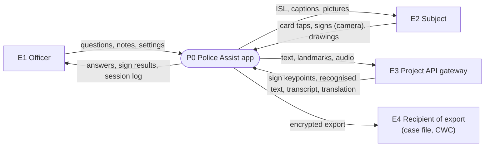
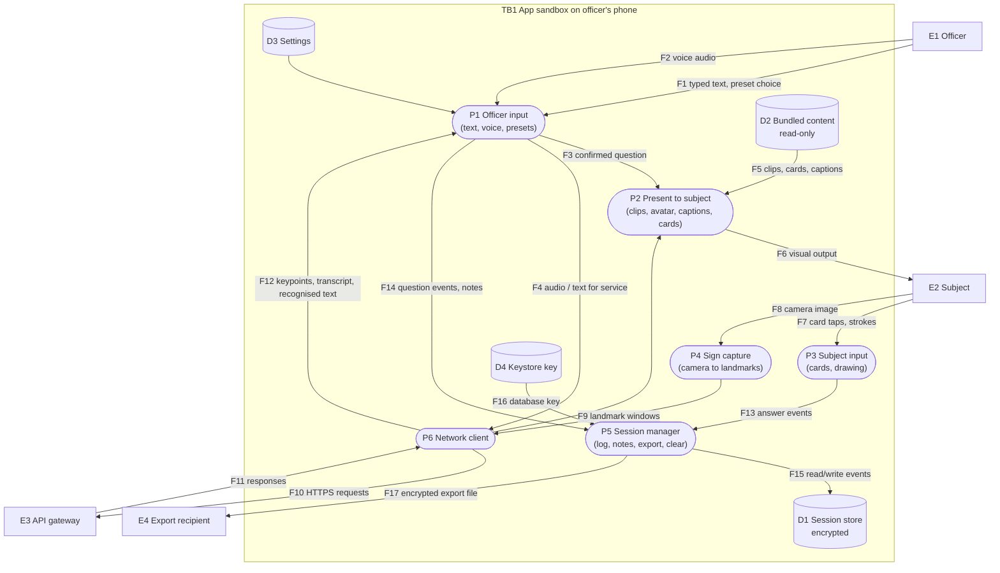
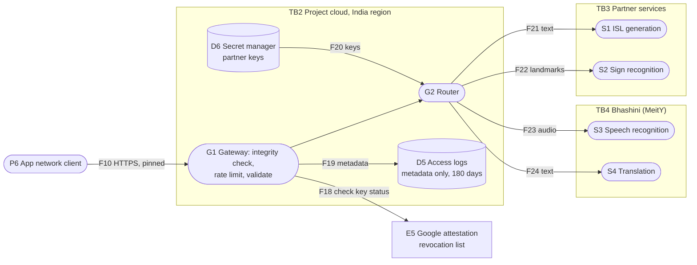

# 04. Data Flow Diagrams

These diagrams are the basis of the [threat model](../governance/07-threat-model.md) and the [DPIA](../governance/08-privacy-dpia.md). Element IDs (E, P, D, F, TB) are referenced there.

Notation: external entities are rectangles, processes are rounded, data stores are cylinders, dashed boxes are trust boundaries.

## Level 0: Context

## Level 1: App

## Level 2: Gateway and partner services

## Trust boundaries

| ID | Boundary | Crosses it | Main concern |
| --- | --- | --- | --- |
| TB0 | Between officer and subject (same screen) | F6, F7, F8 | Subject seeing officer-only information; shoulder surfing by bystanders |
| TB1 | App sandbox on the phone | F1-F8, F10, F11, F17 | Lost or seized phone, other apps, backups, screenshots, rooted device |
| TB2 | Project cloud | F10, F18-F24 | Interception, abuse of API, secret theft, log leakage |
| TB3 | Partner services | F21, F22 | Partner storing or misusing data |
| TB4 | Bhashini | F23, F24 | Retention of audio and text by a third party |

## Data inventory

| Data | Personal? | Where | Flows | Retention |
| --- | --- | --- | --- | --- |
| Questions shown (text) | Possibly (may contain names, places) | D1 | F3, F14, F15, F21, F24 | Session life, max auto-delete period |
| Subject answers (cards, recognised text) | Yes, about the subject | D1 | F13, F15 | Same |
| Drawings | Yes, may contain names or faces | D1 (encrypted blob) | F13, F15 | Same |
| Officer notes | Yes | D1 | F14, F15 | Same |
| Camera images | Yes, biometric-like | Memory only | F8 | Not stored; discarded per frame |
| Hand and pose landmarks | Yes, derived from body | Memory, transit | F9, F10, F22 | Not stored by app; partner must not store [confirm] |
| Voice audio | Yes, officer and possibly subject | Memory, transit | F2, F4, F10, F23 | Not stored by app; Bhashini retention [confirm] |
| Export file | Yes | Leaves the phone | F17 | Recipient's responsibility; encrypted |
| Gateway access logs | Pseudonymous install hash, IP | D5 | F19 | 180 days (CERT-In direction) |
| Settings | No | D3 | | Until uninstall |
| Bundled content | No | D2 | F5 | Until update |
