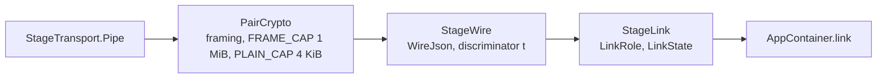
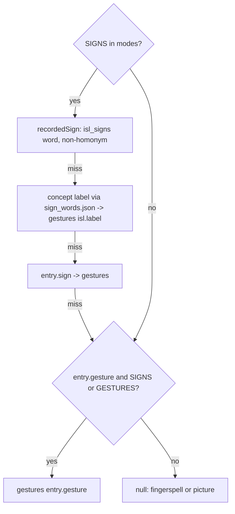

# Internal interfaces

Extension points with their real signatures. Paths are under `app/src/main/java/app/signsetu/` unless noted.

| Seam | File | Implementations | Selected by |
|---|---|---|---|
| `LandmarkTracker` | `camera/LandmarkTracker.kt` | `HolisticTracker`, `DemoTracker` (debug) | `LandmarkTrackers.create` (`app/src/debug`, `app/src/release`) |
| `SignReader` | `sign/SignReader.kt` | `LandmarkSignReader` | `SignReaders.create` |
| `StageTransport` | `pair/StageTransport.kt` | `BluetoothTransport`, `NearbyStageTransport` (nearby), in-process fake (tests) | `StageTransports.create` (`app/src/standard`, `app/src/nearby`) |
| `ContentRepository` | `data/content/Content.kt` | concrete class | `AppContainer.content` |
| `motionFor` | `data/content/IslLexicon.kt` | extension on `ContentBundle` | |
| `planText` | `data/content/TextSigning.kt` | extension on `ContentBundle` | |

## LandmarkTracker

```kotlin
interface LandmarkTracker : AutoCloseable {
    fun track(frame: Bitmap, timestampMs: Long): LandmarkFrame?
    fun warm() {}
    override fun close() {}
}

@Immutable
data class LandmarkFrame(
    val timestampMs: Long,
    val leftHand: List<Offset>? = null,
    val rightHand: List<Offset>? = null,
    val face: List<Offset>? = null,
    val pose: List<Offset>? = null,
    val aspect: Float = 3f / 4f,
) {
    val hands: List<List<Offset>> get() = listOfNotNull(leftHand, rightHand)
}
```

| Contract | Detail |
|---|---|
| Thread | Called on one background thread (`CameraMirror` executor), newest frame only |
| Input | Upright RGBA `Bitmap`; reused after return, never retain it |
| Topology | MediaPipe Holistic: hands 21 points (subject's own left/right), face 468, pose 33; null when not seen |
| Coordinates | Normalised to the frame, origin top-left, not mirrored; `aspect` = width / height |
| `warm()` | Load the model off the main thread; analyse nothing |
| `close()` | Free native memory; next `track`/`warm` reopens. Called on `lock()` and memory trim |
| Return null | No result for this frame (model missing, timestamp not increasing, GPU fallback) |
| Persistence | None; frames stay in memory for the current answer |

Bone tables in the same file: `HandBones`, `ArmBones`, `FaceOutlines`.

Adding a tracker: implement the interface, return it from `LandmarkTrackers.create(context: Context): LandmarkTracker?` in the relevant build-type source set. Returning null shows a plain mirror.

## SignReader

```kotlin
interface SignReader : AutoCloseable {
    val labels: List<String>
    val words: Map<String, String> get() = emptyMap()
    fun read(frames: List<LandmarkFrame>): List<SignGuess>
    override fun close() {}
}

@Immutable
data class SignGuess(val word: String, val score: Float)

object SignReaders {
    fun create(context: Context): SignReader?
}

class LandmarkSignReader(spec: String, weights: ByteArray, override val words: Map<String, String> = emptyMap()) : SignReader
```

| Contract | Detail |
|---|---|
| `labels` | Vocabulary, lower-case English, in model output order |
| `words` | Reader label to app written word (`sign_words.json`) |
| `read` | Frames of one segment; every label with probability, highest first; empty when unreadable |
| Thread | Serialised on `SessionViewModel.readDispatcher` (`Default.limitedParallelism(1)`) |
| Guesses | Suggestions only; recorded as `ANSWER_SIGNED` when the officer accepts or the subject confirms |
| Loading | `SignReaders.create` hash-checks `models/sign_reader.json` and `models/sign_reader.bin` against `manifest.json`; null on any failure |

Segmenting (`sign/SignCapture.kt`):

```kotlin
class SignCapture(window: SignWindow = SignWindow.ANSWER, limitMs: Long = window.limitMs) {
    fun add(frame: LandmarkFrame): List<List<LandmarkFrame>>   // closed segments, usually 0 or 1
    fun finish(): List<List<LandmarkFrame>>
}
enum class SignWindow(val limitMs: Long, val pauseMs: Long, val minMs: Long, val keepFace: Boolean)  // ANSWER, NARRATIVE
```

Post-processing (`sign/SignChoices.kt`): `inContext(guesses, context, signWords, words)`, `signChoices(...)`, `needsSlower(frames, guesses)`, `cardFor(label, signWords, words)`.

Replacing the model: keep the interface, ship new `models/sign_reader.*`, update `labels` in the spec and hashes in `manifest.json`. A different architecture needs a new `SignReader` implementation returned from `SignReaders.create`.

## StageTransport (pairing)

```kotlin
data class Peer(val id: String, val label: String)

class Pipe(val input: InputStream, val output: OutputStream, val peer: String, private val onClose: () -> Unit) : Closeable

interface StageTransport {
    fun peers(): Flow<List<Peer>>
    suspend fun connect(peer: String): Pipe
    suspend fun accept(onlyPeer: String?): Pipe
    fun localName(): String? = null
}

suspend fun <T> closing(close: () -> Unit, block: () -> T): T

object StageTransports {                          // one per flavor source set
    fun create(context: Context): StageTransport?
    fun permissions(context: Context): Array<String>
}
```

| Contract | Detail |
|---|---|
| Android types | None in the interface, so `StageLink` runs in JVM tests |
| `peers()` | Bonded devices (Bluetooth) or discovered endpoints (Nearby) |
| `connect` | Officer side; suspends until connected or throws; cancellation must close the attempt |
| `accept` | Stage side; waits for one officer; `onlyPeer` restricts a resume to the pinned device |
| `Pipe.peer` | Stable id, pinned by the link for resume |
| `localName()` | Shown on the stage waiting screen only; never sent |
| Blocking I/O | Wrap in `closing(close) { ... }`: runs on `Dispatchers.IO`, cancellation calls `close` |
| Permissions | `standard` must not add discovery or location permissions; the build check fails otherwise |

Above the transport (do not change for a new transport):



```kotlin
class StageLink(
    val role: LinkRole,                 // OFFICER, STAGE
    private val transport: StageTransport,
    private val me: Identity,           // versionCode, manifestHash, device label
    private val scope: CoroutineScope,  // single-threaded linkScope
    private val timing: LinkTiming = LinkTiming(),
    private val log: (String) -> Unit = { Log.w("SignSetu", it) },
)
```

Messages: `ToStage` (`Show`, `Ack`, ...) and `ToOfficer` (`Displayed`, `Status`, ...) in `pair/StageWire.kt`; refusal reasons `Abort { PROTOCOL, VERSION, MODE, COMMIT, KEY, SIZE, CODE }` in `pair/PairCrypto.kt`.

Adding a transport: implement `StageTransport` in a flavor source set, return it from that flavor's `StageTransports.create`, add its permissions to `permissions(context)` and to the allowed list in `app/build.gradle.kts`.

## ContentRepository

```kotlin
class ContentRepository(private val assets: AssetManager) {
    suspend fun load(): ContentBundle            // IO; cached after first call
    suspend fun cardImage(id: String): ImageBitmap?   // IO; LruCache(48)
}
```

Selected `ContentBundle` members:

```kotlin
fun groupsFor(role: Role, child: Boolean = false): List<Group>
fun questionsIn(group: String, role: Role, profile: Profile): List<Question>
fun group(id: String): Group?
fun question(id: String): Question?
fun isRights(q: Question): Boolean
fun gestureFor(q: Question): Gesture?
fun gestureFor(phrase: Phrase, slot: PhraseSlot): Gesture?
fun questionAudio(questionId: String, lang: String)
fun greetingAudio(lang: String)
fun subjectAudio(key: String, lang: String)
fun phraseAudio(phrase: Phrase, slot: PhraseSlot, lang: String)
fun language(code: String): Language?
fun subjectText(key: String, lang: String): String?
fun hasCardImage(id: String): Boolean
fun lookup(location: BodyLocation?, action: HandAction?): List<LexiconEntry>
val damaged: Boolean
```

Adding a content file: add the asset, its SHA-256 to `manifest.json`, a `@Serializable` file class and a `verified<T>(name, rejected)` call in `load()`, and a field on `ContentBundle` with a default. Unknown JSON keys are ignored.

## motionFor and word lookup

```kotlin
enum class SignMode { SIGNS, GESTURES, SPELL, PICTURES }

fun ContentBundle.motionFor(word: String, entry: WordEntry?, modes: Set<SignMode>): Gesture?
fun ContentBundle.recordedSign(word: String, entry: WordEntry?): Gesture?
fun ContentBundle.isPhrase(words: String, modes: Set<SignMode>): Boolean
fun ContentBundle.signBack(label: String): Gesture?
fun ContentBundle.dictionary(): List<DictionaryEntry>
fun List<DictionaryEntry>.search(query: String, category: String? = null): List<DictionaryEntry>
```

Resolution order in `motionFor` (single lookup used everywhere):



`recordedSign` prefers the reader label written exactly as typed when several labels share a concept.

## planText

```kotlin
fun ContentBundle.planText(text: String, modes: Set<SignMode>): TextPlan

@Immutable data class TextPlan(val gesture: Gesture?, val beats: List<WordBeat>, val motions: List<String> = emptyList())
data class WordBeat(val range: IntRange, val card: String?, val letters: String?, val start: Float, val end: Float)

fun spelling(word: String): String
fun questionKind(text: String): QuestionKind?
fun devanagariToLatin(word: String): String
```

| Step | Behaviour |
|---|---|
| Tokenise | `[\p{L}\p{M}\p{N}]+(?:['’]\p{L}+)?`, lower case, text after an apostrophe dropped |
| Phrases | Up to 3-token runs merged when `isPhrase` (vocabulary phrase or ISL sign) |
| Fillers | English, Hindi and romanised Hindi grammar words get no sign (unless last token) |
| Order (SIGNS) | ISL order: time signs, rest as typed, negation (`no.shake`), question words |
| Per word | `motionFor`; else fingerspelling (`spelling`, Hindi via `devanagariToLatin`); `PICTURES` adds `entry.card` or `n1`..`n10` for numerals |
| No sign + picture | `PAUSE` beat holds the picture |
| Timing | Beats concatenated with `GAP = 0.3` between words; `WordBeat.start/end` index into `gesture` time |
| Questions | Trailing `?` (or `questionKind`) adds the asking face |
| Output | One merged `Gesture` for the avatar, beats for word highlighting, `motions` = gesture ids used |

Extending: new vocabulary goes in `words.json` (`w`, `sign`, `gesture`, `card`), not code. New grammar or order rules go in `TextSigning.kt` (`FILLER`, `TIME_SIGNS`, `QUESTION_SIGNS`, `islRank`); cover them in `app/src/test`.

## SessionRepository (write path)

```kotlin
class SessionRepository(dao: SessionDao, onSessionStarted: suspend (Long) -> Unit = {}, clock: () -> Long = System::currentTimeMillis) {
    suspend fun start(profile: Profile, subjectLang: String, role: Role = Role.NOT_KNOWN): String
    suspend fun log(
        sessionId: String, type: EventType, source: EventSource,
        lang: String? = null, text: String? = null, cardId: String? = null, lexiconId: String? = null,
        drawingPng: ByteArray? = null, itemId: String? = null, reason: String? = null,
        shownId: Long? = null, via: String? = null,
    ): Long
    fun events(sessionId: String): Flow<List<SessionEvent>>
    suspend fun purge(sessionId: String)
    suspend fun purgeExpired(retentionHours: Int): Int
}
```

Obtain it only through `AppContainer.sessions` (null while locked). See `data-model.md` for columns and event types.
