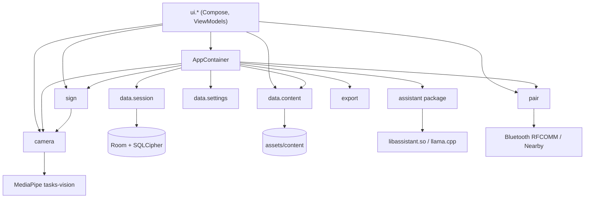
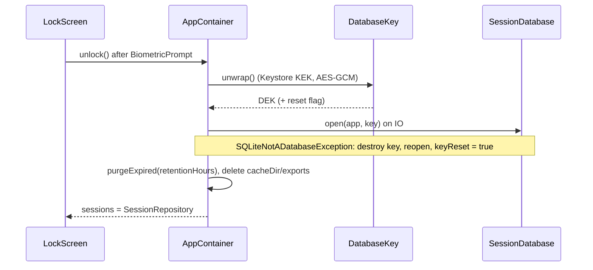
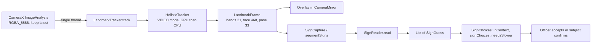

# Architecture

Offline Android app. Kotlin, Jetpack Compose, single activity. Code namespace `app.signsetu`, application ID `in.signsetu` (`in` is a Kotlin keyword). Source root: `app/src/main/java/app/signsetu/`.

## Package map

| Package | Key files | Responsibility |
|---|---|---|
| (root) | `SignSetuApp.kt`, `MainActivity.kt`, `Policy.kt` | `Application`, manual DI (`AppContainer`), process lifecycle, lock/unlock, build expiry |
| `data.session` | `SessionDatabase.kt`, `SessionRepository.kt`, `DatabaseKey.kt`, `RetentionWorker.kt` | Room + SQLCipher store, Keystore-wrapped key, retention purge |
| `data.content` | `Content.kt`, `IslLexicon.kt`, `TextSigning.kt`, `Lesson.kt`, `Completion.kt` | Hash-verified asset loading into `ContentBundle`; word-to-motion lookup; text-to-gesture planning |
| `data.settings` | `SettingsStore.kt`, `OfficerLocale.kt` | DataStore preferences, officer UI locale |
| `camera` | `LandmarkTracker.kt`, `HolisticTracker.kt`, `CameraMirror.kt` | CameraX preview + analysis, MediaPipe Holistic landmarks |
| `sign` | `SignReader.kt`, `SignReaders.kt`, `LandmarkSignReader.kt`, `SignCapture.kt`, `SignChoices.kt`, `SkeletonPlayer.kt` | Isolated sign recognition from landmark segments; replay |
| `pair` | `StageTransport.kt`, `BluetoothTransport.kt`, `StageLink.kt`, `StageWire.kt`, `PairCrypto.kt`, `StageBridge.kt`, `Drawings.kt` | Second-screen link: transport, framing, encryption, protocol state machine |
| `assistant` | `Assistant.kt`, `LocalModel.kt` | On-device language model (llama.cpp over JNI) for translation suggestions |
| `export` | `SessionReport.kt` | Session report rendering (PdfBox) into `cacheDir/exports` |
| `ui` | `AppRoot.kt`, `LockScreen.kt` | Navigation 3 root, biometric lock |
| `ui.session` | `SessionViewModel.kt`, `Interview.kt`, `Stage.kt`, `OfficerPane.kt`, others | Interview flow, officer and subject panes |
| `ui.avatar` | `Rig.kt`, `Avatar.kt`, `MeasuredShape.kt`, `MiniFace.kt` | 2D signing character: keyframe model (`Gesture`, `Key`, `HandKey`), solver, drawing |
| `ui.pair` | `StageDevice.kt`, `PairedBar.kt`, `SecondScreenSheet.kt`, `LinkText.kt` | Pairing UI |
| `ui.start`, `ui.settings`, `ui.components`, `ui.theme` | | First run, start, settings, shared widgets, theme |

Source sets:

| Source set | Contents |
|---|---|
| `app/src/main` | Everything shared |
| `app/src/standard`, `app/src/nearby` | `pair/StageTransports.kt` (+ `NearbyStageTransport.kt` in nearby) |
| `app/src/debug`, `app/src/release` | `camera/LandmarkTrackers.kt` (debug adds `DemoTracker`, enabled by `files/demo_hands`) |
| `app/src/main/cpp` | `CMakeLists.txt`, `assistant.cpp` (JNI to llama.cpp) |
| `app/src/test` | JVM unit tests (protocol, content, planning) |
| `app/src/androidTest` | Compose UI and accessibility tests |

## Layering

Rules: `data.*`, `sign` and `pair` hold no composables. `StageTransport` and `StageLink` stay free of Android types so the protocol runs in JVM tests over an in-process fake.

## AppContainer wiring

`SignSetuApp.onCreate` creates `AppContainer(this)`, registers it on `ProcessLifecycleOwner`, schedules `RetentionWorker`. No DI framework.

| Member | Type | Created | Notes |
|---|---|---|---|
| `content` | `ContentRepository` | eager | `load()` caches one `ContentBundle` |
| `settings` | `SettingsStore` | eager | |
| `report` | `SessionReport` | eager | |
| `models` | `ModelStore` | eager | Model file import, load, release |
| `assistant` | `Assistant(models)` | eager | `suggest(text, language): Suggestion?` |
| `hardKeys`, `stageGuard` | `HardKeys`, `StageGuard` | eager | from `ui.session` |
| `landmarkTracker` | `LandmarkTracker?` | lazy, `LandmarkTrackers.create` | null = plain mirror |
| `signReader` | `SignReader?` | lazy, `SignReaders.create` | null when model missing or hash fails |
| `pairTransport` | `StageTransport?` | lazy, `StageTransports.create` | null = no Bluetooth, pairing hidden |
| `sessions` | `StateFlow<SessionRepository?>` | on `unlock()` | null while locked |
| `link` | `StateFlow<StageLink?>` | `startStage()` / `pairWith(peer)` | at most one, memory only |
| `keyReset` | `StateFlow<Boolean>` | | true after key loss destroyed sessions |
| `deviceLooksRooted`, `buildExpired` | `Boolean` | lazy / getter | warn only |

Key handling (`data/session/DatabaseKey.kt`): 32-byte random DEK, wrapped by a non-exportable Keystore AES key with an auth-validity window, stored at `noBackupFilesDir/dek.bin` as `iv || ciphertext`. `KeyPermanentlyInvalidatedException` or `AEADBadTagException` destroys DB and key and returns a fresh DEK with `reset = true`.

## Threading and coroutines

| Scope / thread | Defined in | Used for |
|---|---|---|
| `scope` = `SupervisorJob + Dispatchers.Main.immediate` | `SignSetuApp.kt` | lock, unlock launch, link start, model release |
| `linkScope` = `Dispatchers.Default.limitedParallelism(1)` | `SignSetuApp.kt` | All `StageLink` state; blocking I/O through `closing { }` on `Dispatchers.IO` (`pair/StageTransport.kt`) |
| `Dispatchers.IO` | `unlock()`, `ContentRepository.load/cardImage`, `ModelStore.import/remove`, `SessionReport` | Disk, DB open, hashing |
| `Dispatchers.Default` | `ModelStore.use` | Native inference |
| `readDispatcher` = `Default.limitedParallelism(1)` | `ui/session/SessionViewModel.kt` | `SignReader.read`, serialised |
| Single-thread `Executor` | `camera/CameraMirror.kt` | `ImageAnalysis` (RGBA_8888, `STRATEGY_KEEP_ONLY_LATEST`) into `LandmarkTracker.track` |
| `viewModelScope` | ViewModels | UI state, repository calls |
| WorkManager `CoroutineWorker` | `data/session/RetentionWorker.kt` | Periodic purge |

`closing(close, block)` exists because platform sockets ignore coroutine cancellation: cancellation calls `close()` on the pipe.

## Lifecycle

| Event | Handler | Effect |
|---|---|---|
| Process `onStop` | `AppContainer.onStop` | Record `backgroundedAt`; officer link `hold()` (stage covers its item) |
| Process `onStart` | `AppContainer.onStart` | Backgrounded more than 5 min (`RELOCK_AFTER_MS`): `lock()`; link `unhold()` |
| `lock()` | main thread | `sessions = null`, repository `closed = true` (late writes dropped), end officer link, release model, close tracker, close DB after 1 s |
| `clearAllData()` | | `lock()` + `DatabaseKey.destroy()` + delete exports |
| `onTrimMemory(>= RUNNING_LOW)` | `ComponentCallbacks2` | Release language model, close landmark graph; both reload on next use |

## Flavors and build types

| Flavor (`transport`) | App ID suffix | Transport | Play services | Extra permissions allowed |
|---|---|---|---|---|
| `standard` (default, reference) | none | `BluetoothTransport` (bonded RFCOMM) | none | none |
| `nearby` | `.nearby` | `NearbyStageTransport` (Nearby Connections) | `play-services-nearby` | location, `BLUETOOTH_SCAN/ADVERTISE/ADMIN`, `NEARBY_WIFI_DEVICES` |

| Build type | ABIs | Minify | Tracker |
|---|---|---|---|
| debug | `arm64-v8a`, `x86_64` | no | Holistic, or `DemoTracker` when `files/demo_hands` exists |
| release | `arm64-v8a`, `armeabi-v7a` | R8 + resource shrink | Holistic (64-bit only) |

Build gates in `app/build.gradle.kts`:

| Gate | Mechanism |
|---|---|
| Forbidden permissions | `check<Variant>Permissions` before every assemble/bundle/install/package task; `INTERNET`, `RECORD_AUDIO`, `ACCESS_BACKGROUND_LOCATION` always, discovery permissions in `standard` |
| Pinned versions | `dependencyLocking { lockAllConfigurations() }`, `gradle.lockfile`; update with `--write-locks` |
| Room schema | `ksp { arg("room.schemaLocation", "$projectDir/schemas") }` |
| Build expiry | `BuildConfig.BUILD_EPOCH_DAY` read by `buildExpired` |
| Uncompressed assets | `noCompress` `webp`, `ogg`, `mp4`, `task` |
| All languages in every install | `bundle.language.enableSplit = false` |

SDK: compile/target 37, min 29, Java 17, NDK `30.0.16248370`, CMake `4.1.1`.

## Native language model

| Item | Value |
|---|---|
| Build | `app/src/main/cpp/CMakeLists.txt`; `FetchContent` llama.cpp `v0.5.0` tarball, SHA-256 pinned |
| Flags | static; no tests, tools, server, curl, OpenSSL; `GGML_NATIVE OFF`, `GGML_OPENMP OFF`, `GGML_BACKEND_DL OFF`; x86_64 adds AVX, AVX2, FMA, F16C |
| Output | `libassistant.so`, linked with `-Wl,-z,max-page-size=16384` (16 KB pages) |
| JNI | `LocalModel.nativeLoad(path: String, threads: Int, context: Int): Long`, `nativeChat(handle: Long, system: String, user: String, maxTokens: Int): String`, `nativeFree(handle: Long)` |
| Kotlin | `assistant/LocalModel.kt` (`LocalModel`, `ModelStore`), `assistant/Assistant.kt` (`Suggestion`, `needsTranslation`) |
| Model file | Not bundled; imported by the officer through `ModelStore.import(uri)` |
| States | `ModelStore.State { NOT_INSTALLED, READY, TOO_LITTLE_MEMORY, UNSUPPORTED }` |
| Concurrency | Mutex around load/unload; `use { }` on `Dispatchers.Default`; `release()` on lock and memory trim |

## MediaPipe pipeline

| Stage | File | Notes |
|---|---|---|
| Model | `assets/content/models/holistic_landmarker.task` | Uncompressed, SHA-256 checked against `manifest.json` on first open |
| Gate | `holisticTracker(context)` in `camera/HolisticTracker.kt` | 64-bit ABI and model present, else null |
| Inference | `HolisticTracker.track` | Timestamps must increase; a GPU runtime failure reopens on CPU |
| Packaging | `packaging.jniLibs.excludes` | `lib/armeabi-v7a/libmediapipe_tasks_jni.so` dropped |
| Dependency hygiene | excludes on `tasks-vision` | `transport-backend-cct` removed (brings `INTERNET`); `protobuf-javalite` replaced by `protobuf-java` |
| Reader | `sign/LandmarkSignReader.kt` | Spec `models/sign_reader.json` + weights `models/sign_reader.bin`, hash-checked in `SignReaders.create` |

Frames and landmarks live in memory only; nothing from the camera is persisted.

## Dependencies

From `gradle/libs.versions.toml`.

| Area | Artifact | Version |
|---|---|---|
| Build | Android Gradle Plugin | 9.4.1 |
| | Kotlin (compose, serialization plugins) | 2.4.21 |
| | KSP | 2.3.12 |
| UI | Compose BOM | 2026.09.00 |
| | material-icons-core | 1.7.8 |
| | activity-compose | 1.13.0 |
| | core-ktx | 1.19.1 |
| | lifecycle (runtime-compose, viewmodel-compose, process, viewmodel-navigation3) | 2.11.0 |
| | navigation3 (runtime, ui) | 1.2.0 |
| | fragment-ktx | 1.9.1 |
| | biometric | 1.1.0 |
| Storage | Room (runtime, ktx, compiler) | 2.8.5 |
| | sqlcipher-android | 4.19.1 |
| | androidx sqlite-ktx | 2.7.1 |
| | datastore-preferences | 1.2.1 |
| | work-runtime-ktx | 2.12.0 |
| Media | media3-exoplayer | 1.11.1 |
| | CameraX (camera2, lifecycle, compose) | 1.6.2 |
| | MediaPipe tasks-vision | 1.0.0 |
| | protobuf-java | 4.26.1 |
| Export | pdfbox-android | 2.0.27.0 |
| | BouncyCastle prov, pkix, util (constraint) | 1.86 |
| Core | kotlinx-serialization-json | 1.11.0 |
| | kotlinx-coroutines-android, -test | 1.11.0 |
| Pairing | play-services-nearby (`nearby` only) | 19.5.1 |
| Native | llama.cpp (CMake FetchContent) | v0.5.0 |
| Test | junit | 4.13.2 |
