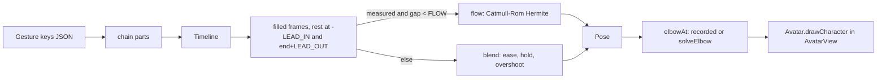
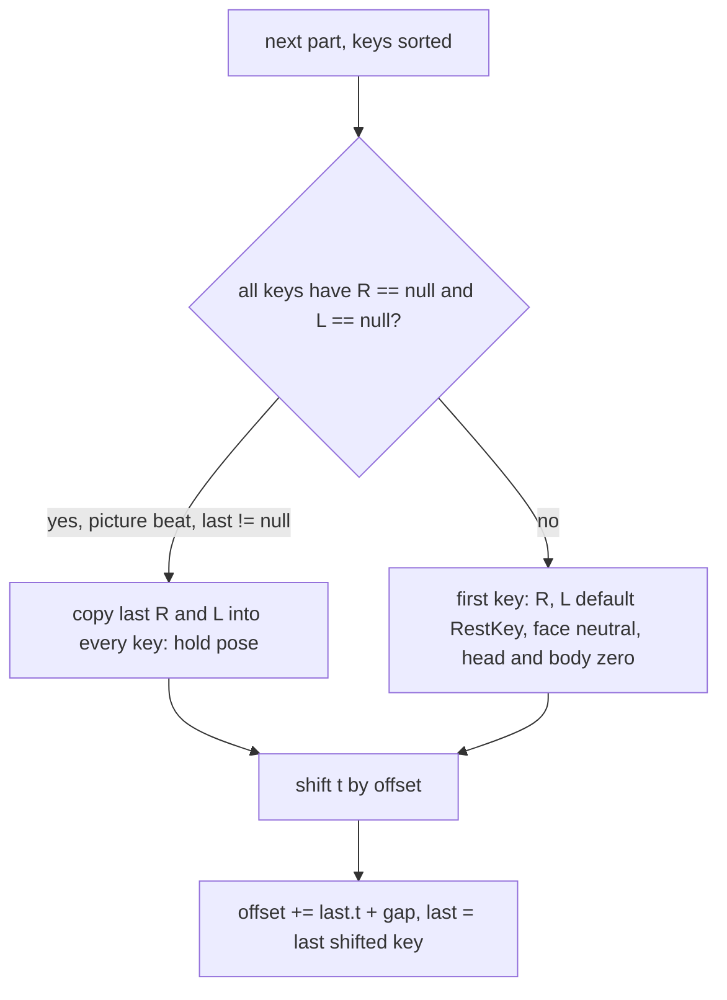
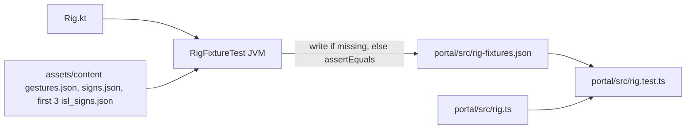

# Avatar rig

Source of truth: `app/src/main/java/app/signsetu/ui/avatar/Rig.kt`. Drawing: `ui/avatar/Avatar.kt`. Measured shapes: `ui/avatar/MeasuredShape.kt`. Port: `portal/src/rig.ts`.

## Pipeline

## Space and builds

- Character space: 200 units wide, `CENTER = 100`. y down.
- `Side.R.sign = -1`, `Side.L.sign = +1`. Character right is viewer left.
- `Build`: head, neck, `shoulderY`, `shoulderHalf`, `upperArm`, `foreArm`, `handScale`, anchors. `ChildBuild`, `AdultBuild`.
- `shoulder(s) = (CENTER + s * shoulderHalf, shoulderY)`.
- `rest(s) = (CENTER + s * (shoulderHalf - 6), 206)`.

### Anchors

Anchors are stored for the right side. Sided set `SIDED = {cheek, ear, shoulder, temple, side, eye, hip, arm, nose_side, hair_side}`.

$$
\text{anchor}(n, s) = \begin{cases} (C + (x - C)\cdot \frac{s'}{-1},\ y) & n \in \text{SIDED} \\ (x, y) & \text{otherwise} \end{cases}
$$

with `s' = s`, or the other side when the name ends `_opp`.

Target resolution (`Timeline.resolve`):

1. `at == "rest"` gives `rest(s)`.
2. `at` in `OTHER_HAND` (`wrist_opp`, `palm_opp`, `thumb_opp`, `index_opp` .. `pinky_opp`) gives `other.point(part, opposite side)`. That hand is solved first, `rFront = true`.
3. Else `anchor(at, s)`, fallback `rest(s)`.
4. Offset: `(x + dx * s, y + dy)`. `+dx` is outward.
5. `reachBack`: move target back along the hand so `touch` lands on the anchor. With $\theta = \text{angle}\cdot s$:

$$
(x - \sin\theta\cdot r,\ y + \cos\theta\cdot r),\quad r \in \{\text{palm } 6.5,\ \text{thumb } 9,\ \text{tip } 12 + 9.5(1 - 0.75\,c_{index})\}\cdot \text{handScale}
$$

## Two-bone elbow: `solveElbow`

Shoulder $S$, wrist target $T$, lengths $u$ (upper), $f$ (fore).

$$
d = \text{clamp}(|T - S|,\ |u - f| + 0.01,\ u + f - 0.01),\quad \beta = \text{atan2}(T_y - S_y, T_x - S_x)
$$

$$
\alpha = \arccos\left(\text{clamp}\left(\frac{u^2 + d^2 - f^2}{2ud}, -1, 1\right)\right),\quad E_{1,2} = S + u(\cos(\beta \pm \alpha), \sin(\beta \pm \alpha))
$$

Score, with outward $o = (E_x - C)\cdot s$ and `elbowOut` $k$ (`out` 1, `down` 0, `in` -1):

$$
\text{score}(E) = \begin{cases} o\,k + E_y(1 - k) & k \ge 0 \\ -o & k < 0 \end{cases}
$$

Pick $E_1$ if $\text{score}(E_1) \ge \text{score}(E_2) - 10^{-3}$. The margin is deliberate: a level reach gives mirror elbows with equal scores; rig.ts uses the same margin.

## Recorded elbows (`ex`, `ey`)

- `HandKey.ex/ey`: elbow offset from this side's shoulder, `+ex` outward. Screen offset = `(ex * s, ey)`.
- `HandPose.elbowX/Y`: screen offset, NaN means solve.
- `elbowAt(sx, sy)`: recorded gives `(sx + elbowX, sy + elbowY)` (follows a shrugged shoulder), else `solveElbow`.

Blend rule in `hand(a, b)`:

| a | b | elbow endpoints |
|---|---|---|
| solved | solved | none, NaN, solve at draw time |
| recorded | recorded | lerp(ea, eb, m) |
| recorded | solved | eb = `solvedElbow(pb)` against unshifted shoulder |
| solved | recorded | ea = `solvedElbow(pa)` |

Mixed pairs start or end at the solve, so there is no jump when a recorded sign eases in from rest and back out.

## Easing, holds, overshoot (`blend`, `hand`)

Segment `a -> b`, local `t`:

$$
h = \min(0.08,\ 0.25(t_b - t_a)),\quad \text{raw} = \text{clamp}\left(\frac{t - t_a}{t_b - t_a - h}, 0, 1\right)
$$

The move lands `h` early and holds, so the shape reads before the next one.

- `ease` (cubic in-out): $4f^3$ for $f < 0.5$, else $1 - (2 - 2f)^3/2$. Used for shape, roll, face, head, body, `elbowOut`.
- `easeOutBack` ($c_1 = 1.1$): $1 + (c_1 + 1)g^3 + c_1 g^2$, $g = f - 1$. Position, angle and elbow for free moves only: `touch == "wrist"`, not `OTHER_HAND`, neither end `rest`. Contacts never pass their target.
- Angle: both NaN gives NaN (follow forearm). One NaN switches at f = 0.5. `prop` switches at 0.5.
- Lead: `LEAD_IN = 0.35 s` from rest, `LEAD_OUT = 0.45 s` to rest. `duration = LEAD_IN + last.t + LEAD_OUT`.
- `filled()`: each key inherits the previous frame's values for missing `R`, `L`, `face`, `head`, `body`.

## Catmull-Rom for recorded keys (`flows`, `flow`)

`flows(i)`: next key gap `< FLOW = 0.35 s` and both frames `measured` (any hand shape starts `c:`).

Track vector per hand (13): `x, y, roll, angle*s, 5 curls, thumbAcross, spread, ex, ey` (elbow recorded or solved offset).

Tangents (zero where a run starts or ends):

$$
m_1 = \frac{p_2 - p_0}{t_2 - t_0}(t_2 - t_1),\quad m_2 = \frac{p_3 - p_1}{t_3 - t_1}(t_2 - t_1)
$$

Cubic Hermite, $u$ linear in time (no ease, no hold):

$$
H(u) = (2u^3 - 3u^2 + 1)p_1 + (u^3 - 2u^2 + u)m_1 + (-2u^3 + 3u^2)p_2 + (u^3 - u^2)m_2
$$

Curls clamped [0, 1], spread [-1, 1]. Angle used only when both keys set it. Elbow used only if either key is recorded. Face, head and body still come from `blend`.

## `chain()` and picture-beat holds

`chain(id, parts, gap = 0.3)` joins gestures into one sentence (FR-62).

The first-key fill makes each part start from the same pose as when it plays alone. The hold stops a hands-free picture beat from dropping to rest mid-sentence.

## Hand shapes

`HandShape(thumb, index, middle, ring, pinky, thumbAcross, spread)`: curls 0 straight to 1 bent, `thumbAcross` 0 beside to 1 over palm, spread -1 to 1.

- Named: `HandShape.ALL` (`RELAX`, `FLAT`, `OPEN`, `FIST`, `POINT`, `TWO` .. `HOOK`). Unknown name plays `RELAX`.
- Measured: `"c:T,I,M,R,P,A,S"` in percent, exactly 7 ints. Curls and A clamp to [0, 1], S to [-1, 1]. Else null, so RELAX (`MeasuredShape.kt`).
- `blendShape` = per-field lerp with eased f.
- `HandPose.point(part)`: frontal hand layout (palm width 13), rotated by angle, times `handScale`. Fingers stack on the centre line when `|roll| < 0.35`. Must mirror `Avatar.drawHand`.

## Framing (`Avatar.kt`)

`AvatarView.Body = (left -10, top 0, w 220, h 258)`, `AVATAR_ASPECT = 220 / 258`. `Head = (0, 0, 200, 200)` for `MiniFace`.

$$
\text{unit} = \frac{H_{px}}{258},\quad o_x = \frac{W_{px} - 220\,\text{unit}}{2} + 10\,\text{unit},\quad o_y = 0
$$

`Stage.kt` sizes the avatar with `aspectRatio(AVATAR_ASPECT)` and height `min(maxHeight - 48 or 64 dp, (maxWidth - 2 SideBand) / AVATAR_ASPECT)`. Body view holds both hands at rest, at waist and flat on the head.

## Parity with the portal

- Sample grid: every gesture x {child, adult} x t = duration x {0.21, 0.47, 0.79}, rounded 4 dp.
- Pose vector (47): per hand R then L `x, y, roll, angle|null, elbowOut, 5 curls, thumbAcross, spread, elbowX, elbowY, indexTipX, indexTipY` (16), then 8 face values, `tilt, nod, turn, lean, shrug, hunch, shiver`.
- Kotlin is 32-bit float, fixtures keep 4 decimals, the TS test compares within that tolerance. `-0.0000` written as `0.0000`.
- The TS test also checks the fixture gesture set equals all non-`isl.` gestures plus the first 3 `isl.`.

Changing Rig.kt on purpose:

1. Delete `portal/src/rig-fixtures.json`.
2. `./gradlew :app:testStandardDebugUnitTest --tests app.signsetu.RigFixtureTest` (writes it).
3. Port the change to `portal/src/rig.ts`.
4. `cd portal && npx vp test run` (`vp test`) must pass.
