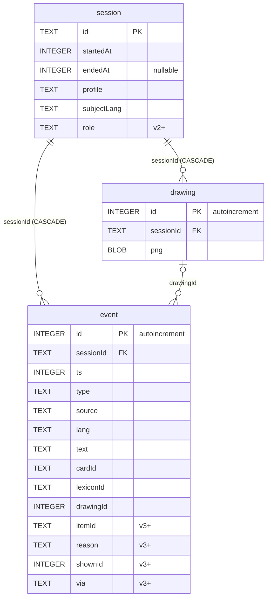
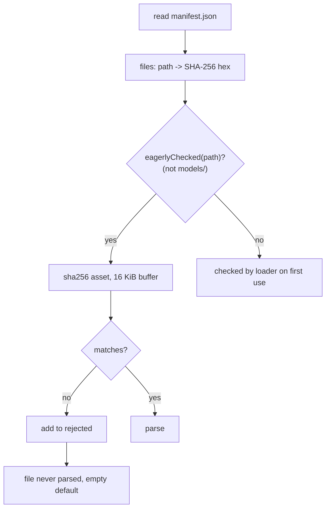

# Data model

Two stores: the encrypted session database (Room + SQLCipher, `app/src/main/java/app/signsetu/data/session/`) and read-only content assets (`app/src/main/assets/content/`, loaded by `data/content/Content.kt`). Settings live in DataStore (`data/settings/SettingsStore.kt`).

## Session database

| Property | Value |
|---|---|
| Class | `SessionDatabase` (`data/session/SessionDatabase.kt`), current `version = 3`, `exportSchema = true` |
| File | `session.db` (`SessionDatabase.FILE_NAME`) |
| Encryption | SQLCipher `SupportOpenHelperFactory(key)`, 32-byte DEK from `DatabaseKey.unwrap()` |
| Journal | `JournalMode.TRUNCATE` (no WAL keeping old pages) |
| Pragma | `secure_delete = ON` in `onOpen` |
| Downgrade | `fallbackToDestructiveMigrationOnDowngrade(dropAllTables = true)` |
| Exported schemas | `app/schemas/app.signsetu.data.session.SessionDatabase/{1,2,3}.json` |
| Personal data | No column holds a subject's name, address, phone number or photograph |



### Schema per version

| Table | v1 | v2 | v3 |
|---|---|---|---|
| `session` | `id` TEXT PK, `startedAt` INTEGER NN, `endedAt` INTEGER, `profile` TEXT NN, `subjectLang` TEXT NN | + `role` TEXT NN DEFAULT `'VICTIM'` | unchanged |
| `event` | `id` INTEGER PK, `sessionId` TEXT NN, `ts` INTEGER NN, `type` TEXT NN, `source` TEXT NN, `lang`, `text`, `cardId`, `lexiconId` TEXT, `drawingId` INTEGER | unchanged | + `itemId` TEXT, `reason` TEXT, `shownId` INTEGER, `via` TEXT |
| `drawing` | `id` INTEGER PK, `sessionId` TEXT NN, `png` BLOB NN | unchanged | unchanged |
| Indexes | `event(sessionId)`, `drawing(sessionId)` | same | same |
| Identity hash prefix | `2828971f9fd6` | `a0ffbb364bc9` | `351bdeaca991` |

### Migrations

| Migration | SQL |
|---|---|
| `MIGRATION_1_2` | `ALTER TABLE session ADD COLUMN role TEXT NOT NULL DEFAULT 'VICTIM'` |
| `MIGRATION_2_3` | `ALTER TABLE event ADD COLUMN itemId TEXT`; `... reason TEXT`; `... shownId INTEGER`; `... via TEXT` |

Adding a version: bump `version`, add a `Migration(n, n+1)` to `addMigrations(...)`, build to export `app/schemas/.../{n+1}.json`, commit the schema. The `role` column default only backfills pre-v2 rows; `SessionEntity.role` defaults to `NOT_KNOWN` for new rows.

### Enums stored as `TEXT` (`data/session/SessionRepository.kt`)

| Enum | Values | Column |
|---|---|---|
| `Profile` | `YOUNG_CHILD`, `ISL_USER`, `OTHER_LANGUAGE`, `NOT_SURE` | `session.profile` |
| `Role` | `NOT_KNOWN`, `VICTIM`, `ACCUSED` | `session.role` |
| `EventType` | see below | `event.type` |
| `EventSource` | `PRESET`, `TEXT`, `BOARD`, `SHOW_BACK`, `SUBJECT`, `OFFICER`, `PHRASE`, `RULE`, `MACHINE` | `event.source` |

Values are read with `valueOf`; renaming or removing a constant breaks existing rows. Append only.

### Event types

| `EventType` | Source(s) | Meaning | Columns written |
|---|---|---|---|
| `QUESTION_SHOWN` | `PRESET`, `TEXT`, `BOARD`, `PHRASE`, `SHOW_BACK` | Item put to the subject | `lang`, `text` |
| `ANSWER_CARD` | `SUBJECT` | Picture card chosen | `lang`, `text` (card label) |
| `ANSWER_DRAWING` | `SUBJECT` | Drawing answer | `drawingId` (from `drawingPng`), `shownId`, `via` |
| `ANSWER_GESTURE` | `SUBJECT` | Body-map / lexicon gesture | `lang`, `text`, `cardId`, `lexiconId`, `shownId`, `via` |
| `ANSWER_UNCLEAR` | `SUBJECT` | Answer could not be read | `text`, `cardId`, `lexiconId`, `shownId`, `via` |
| `ANSWER_TEXT` | `SUBJECT` | Typed answer or personal detail | `lang`, `text`, optional `itemId`, `reason` |
| `ANSWER_SIGNED` | per caller | Sign read from landmarks, accepted or confirmed | `text`, `lang`, `shownId` (`SessionViewModel.logSigned`) |
| `LANGUAGE_CHOSEN` | `SUBJECT` | Subject language set | `lang` (code), `text` (language name) |
| `NOTE` | `OFFICER` | Officer note | `lang`, `text` |
| `SYSTEM` | `OFFICER`, `SUBJECT` | App record (break given, rules skipped, pause end, ...) | `text` (`SYSTEM_*` key) |
| `SUGGESTED` | `RULE` | Next item proposed | `itemId`, `reason` |
| `APPROVED` | `OFFICER` | Officer approved a proposal | `itemId` |
| `SKIPPED` | `OFFICER` | Proposal skipped | `itemId`, `reason` |
| `AUTO_ADVANCED` | `RULE` | Flow advanced by rule | `itemId` |
| `LINK` | `OFFICER` | Second-screen link change | `text` |
| `PROMPT` | `OFFICER` | Prompt text recorded | `lang`, `text` |

`shownId` points at the `event.id` of the item an answer responds to; `via` marks answers given on the paired stage. Column usage per type is a caller convention (`ui/session/SessionViewModel.kt`, `ui/session/AutoPilot.kt`), not a schema constraint.

### Write and retention rules

| Rule | Where |
|---|---|
| Event persisted before the UI reflects it; `log` returns the event id | `SessionRepository.log` |
| Writes after `lock()` are dropped (`closed = true`, returns `-1`) | `SessionRepository.unlessClosed` |
| Purge on unlock: `DELETE FROM session WHERE startedAt < now - retentionHours` | `purgeExpired`, `AppContainer.unlock` |
| Hourly worker; when every session is past retention, `clearAllData()` (key destroyed) | `RetentionWorker`, `allSessionsExpired` |
| Default retention 24 h | `AppSettings.DEFAULT_RETENTION_HOURS` |
| Exports deleted on unlock and on clear | `cacheDir/exports` |

## Content assets

Root: `app/src/main/assets/content/`. All JSON decoded with `Json { ignoreUnknownKeys = true }` into `ContentBundle`.

| File | Decoded as | Bundle field |
|---|---|---|
| `manifest.json` | `Manifest(files: Map<String, String>)` | `files`, `manifestHash`, `version` |
| `triage.json` | `TriageFile(groups, questions)` | `groups`, `questions` |
| `cards.json` | `CardsFile(categories, cards)` | `categories`, `cards` |
| `lexicon.json` | `LexiconFile(entries)` | `lexicon` |
| `languages.json` | `LanguagesFile(languages)` | `languages` |
| `subject_ui.json` | `Map<String, Localized>` | `subjectUi` |
| `gestures.json` | `GesturesFile(gestures)` | `gestures` (merged) |
| `signs.json` | `GesturesFile(gestures)` | `gestures` (merged) |
| `isl_signs.json` | `IslSigns` | `isl`, plus each `IslSign.gesture` into `gestures` |
| `words.json` | `WordsFile(words: List<WordEntry>)` | `words` (one map key per form in `w`) |
| `sign_words.json` | `SignWordsFile(words: Map<String, String>)` | `signWords` (reader label to written word) |
| `phrases.json` | `PhrasesFile(phrases)` | `phrases` |
| `places.json` | `PlacesFile(states)` | `states` |
| `cards/<id>.webp` | bitmap, `LruCache(48)` | `ContentRepository.cardImage(id)` |
| `audio/<lang>/<key>.ogg`, `audio/greet/<lang>.ogg` | ExoPlayer | `questionAudio`, `subjectAudio`, `phraseAudio`, `greetingAudio` |
| `models/holistic_landmarker.task` | MediaPipe | `HolisticTracker` |
| `models/sign_reader.json`, `models/sign_reader.bin` | reader spec + weights | `SignReaders.create` |

`Localized` is a language-code map (`"en"`, `"hi"`, ...) read with `Localized.pick(lang)`.

### Motion files: `gestures.json`, `signs.json`, `isl_signs.json`

All three share the keyframe model in `ui/avatar/Rig.kt`.

```
Gesture  { id: String, keys: [Key] }
Key      { t: Float, R?: HandKey, L?: HandKey, face?: String, head?: HeadKey, body?: BodyKey }
HeadKey  { tilt = 0, nod = 0, turn = 0 }
BodyKey  { lean = 0, shrug = 0, hunch = 0, shiver = 0 }
```

| `HandKey` field | Type, default | Meaning |
|---|---|---|
| `at` | String, `"rest"` | Body anchor (`mouth`, `cheek`, `chest`, `shoulder`, `side`, `belly`, `front`, `thumb_opp`, ...); sided anchors use this hand's side |
| `dx`, `dy` | Float, 0 | Offset from anchor in rig units; `+dx` outward |
| `shape` | String, `"RELAX"` | Named shape (`HandShape.ALL`: `OPEN`, `POINT`, `BUNCH`, `CUP`, `PINCH`, `CLAW`, ...) or measured `c:` shape |
| `roll` | Float, -1 | 1 palm to viewer, 0 thumb side, -1 back of hand |
| `angle` | Float?, null | Degrees; 0 fingers up, positive tips outward; null follows forearm |
| `elbow` | String, `"out"` | Solved elbow hint (`out`, `down`, ...) |
| `ex`, `ey` | Float?, null | Recorded elbow as offset from this side's shoulder, `+ex` outward; overrides `elbow` when both neighbouring keys have it |
| `touch` | String, `"wrist"` | Contact point: `wrist`, `palm`, `tip`, `thumb` |
| `prop` | String?, null | Held object, for example `stick` |

`face` names a preset in `Face.PRESETS`: `neutral`, `smile`, `happy`, `ask`, `gentle`, `concern`, `wince`, `sleepy`, `round`, `cold`, `hot`.

Measured shape (`ui/avatar/MeasuredShape.kt`, `handShape(name)`):

```
"c:" thumb, index, middle, ring, pinky, thumbAcross, spread
```

Seven integers in percent. The first six are curls clamped to 0..100; `spread` clamps to -100..100. Any other count or a non-integer yields null (plays as the relaxed hand).

| File | Top-level keys | Content | Author |
|---|---|---|---|
| `gestures.json` | `version`, `note`, `gestures` | Everyday gestures and authored signs (`face`, `head`, `body` channels used) | hand-edited |
| `signs.json` | `note`, `gestures` | Fingerspelling letters (`letter.*`) and digits, two-handed ISL alphabet | generated by `tools/content/build_signs.py`; edit the script |
| `isl_signs.json` | `note`, `source`, `review`, `categories`, `gestures` | Signs recorded from signers (`isl.<word>`), measured `c:` shapes, `ex`/`ey` elbows; `R` and `L` channels only | generated from the INCLUDE dataset pose release (CC BY 4.0) |

`IslSign` (`data/content/IslLexicon.kt`):

| Field | Type | Meaning |
|---|---|---|
| `id` | String | `isl.<word>` |
| `word` | String | English label, lower case |
| `hi` | String | Hindi label |
| `category` | String | Key into `categories` (`Localized`) |
| `rec` | String | Source recording path |
| `homonym` | Boolean | True: skipped by direct word lookup |
| `keys` | `List<Key>` | Keyframes |

Example key (from `isl.actor`):

```json
{"t": 0.32,
 "R": {"at": "shoulder", "dx": 14, "dy": -30, "shape": "c:5,70,85,90,90,5,85",
       "roll": 0.0, "angle": -48, "elbow": "down", "ex": 32, "ey": 10},
 "L": {"at": "side", "dx": 5, "dy": 8, "shape": "c:15,40,40,45,45,40,15",
       "roll": -0.1, "angle": 166, "elbow": "down", "ex": 6, "ey": 40}}
```

### Vocabulary files

| File | Entry shape | Example |
|---|---|---|
| `words.json` | `WordEntry { w: [String], sign?: String, gesture?: String, card?: String }` | `{"w": ["mother", "maa", "माँ", ...], "sign": "mother.nosering", "gesture": "mother.bindi", "card": "mother"}` |
| `sign_words.json` | `{ "words": { "<reader label>": "<written word>" } }` | `"mother": "mother"` |

`sign` and `gesture` are ids into `ContentBundle.gestures`; `card` is a card id (`cards/<id>.webp`).

## Manifest hashing



| Rule | Detail |
|---|---|
| Format | `{"files": {"<path relative to content/>": "<lowercase hex SHA-256>"}}`; 205 entries |
| Eager check | Every non-`models/` file hashed on each `load()` |
| Lazy check | `models/*` hashed by `HolisticTracker` and `SignReaders.create` before use; mismatch means no tracker or reader |
| Rejected file | Never parsed; its section loads empty |
| `ContentBundle.files` | `manifest.files.keys - rejected` (gates `hasCardImage`) |
| `damaged` | True when a rejected `.json` is not a motion file; motion-file failure only loses animation |
| `manifestHash` | SHA-256 of `manifest.json` bytes; sent in pairing `Identity` so both devices run identical content |
| `version` | First 6 bytes of SHA-256 of the manifest text, hex |
| Regeneration | Any asset change requires updating its hash in `manifest.json`, otherwise the file is rejected at runtime |
