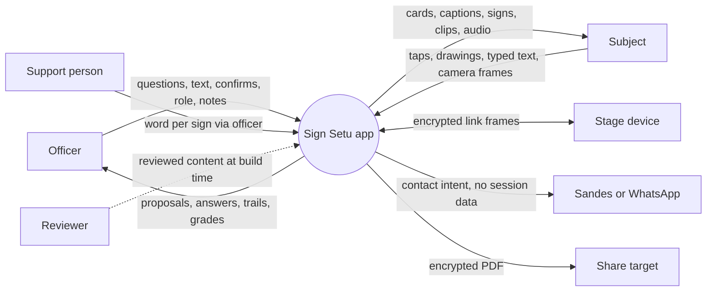
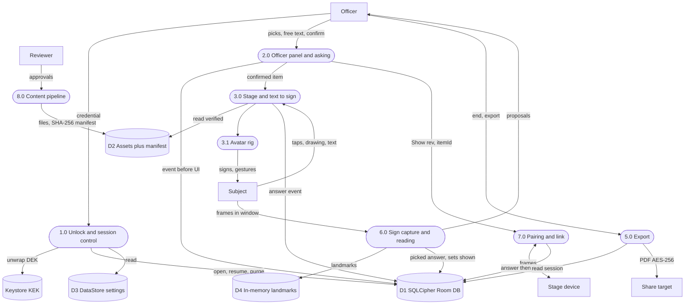
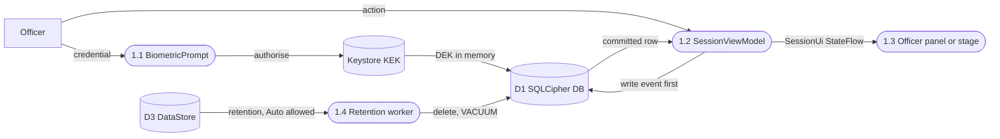
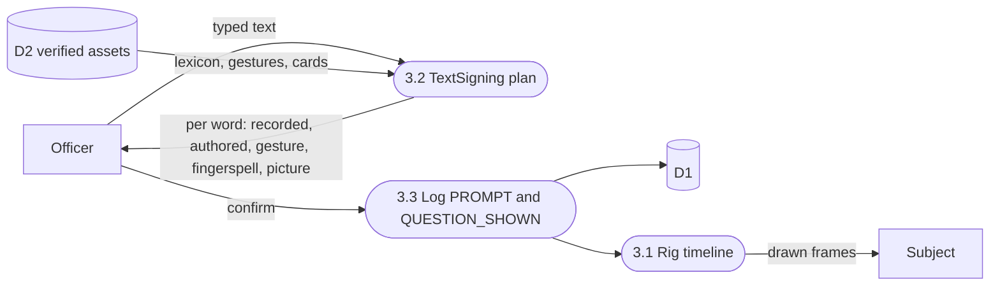
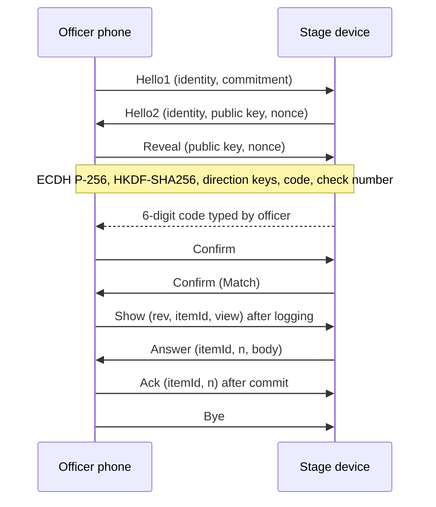
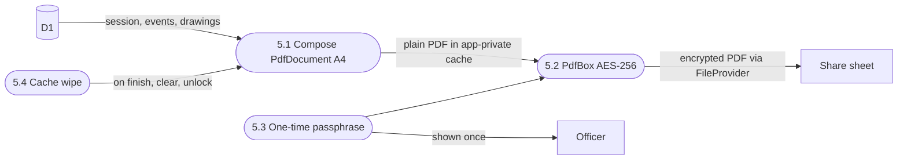
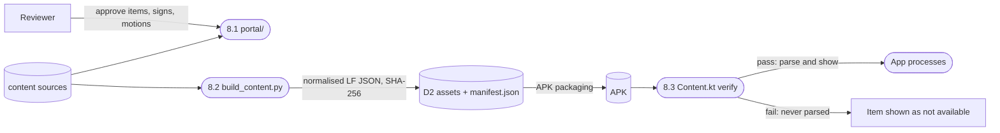
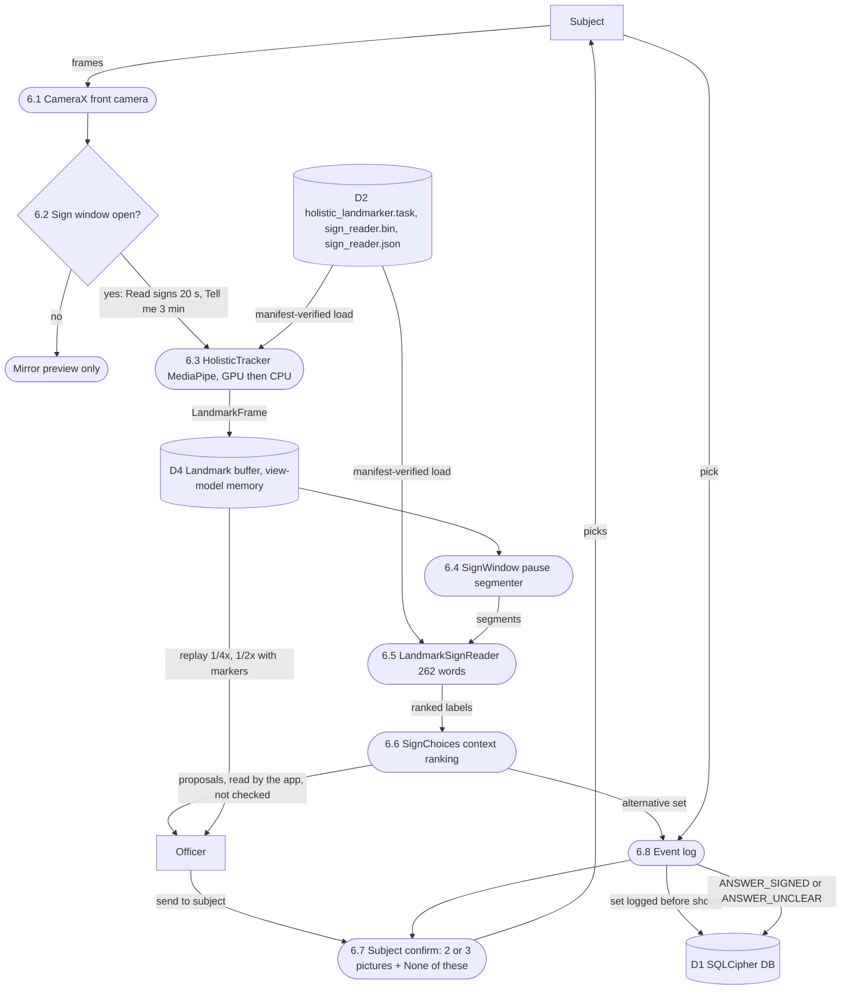
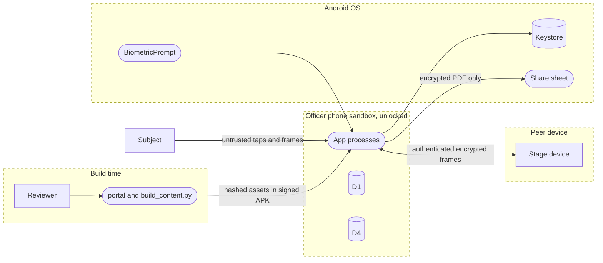

# Sign Setu: Data Flow Diagrams

Notation: rectangles are external entities, rounded boxes are processes, cylinders are data stores, dashed subgraphs are trust boundaries. Process numbers 1.0, 2.0, 3.0, 3.1, 5.0 and 7.0 match the DFD column of [02-architecture.md](../02-architecture.md) §4. Process 6.0 here groups what that table calls 3.5 (capture) and 3.6 (reading), since 6.0 there is the on-device assistant; 8.0 (content pipeline) is local to this document.

## 1. Level 0: context

## 2. Level 1

| Process | Code | Requirements |
| --- | --- | --- |
| 1.0 Session control | `MainActivity`, `AppContainer`, `ui.start`, `data.session` | FR-05, FR-06, FR-33, FR-34, FR-61, FR-67, FR-101 |
| 2.0 Officer panel | `ui.session`, `data.content` (`IslLexicon`, `Lesson`) | FR-10 to FR-19, FR-77 to FR-83, FR-88 to FR-91 |
| 3.0 Stage, text to sign | `ui.session` stage, `data.content/TextSigning.kt` | FR-13, FR-20 to FR-24, FR-69, FR-70, FR-95 to FR-107 |
| 3.1 Avatar | `ui.avatar` (`Rig.kt`, `Avatar.kt`) | FR-11, FR-13 |
| 6.0 Sign capture | `camera`, `sign` | FR-84 to FR-87 |
| 7.0 Pairing | `pair`, `ui.pair`, flavor `src/standard`, `src/nearby` | FR-72 to FR-76 |
| 5.0 Export | `export` | FR-32, FR-94, FR-104 |
| 8.0 Content pipeline | `portal/`, `tools/content/build_content.py` | SEC-54, SEC-74 |

### 2.1 Session

### 2.2 Text to sign

### 2.3 Pairing

### 2.4 Export

### 2.5 Content pipeline

## 3. Level 2: sign capture (6.0)

| Step | Code | Rule |
| --- | --- | --- |
| 6.2 | `sign/SignWindow` | Analysis only inside a window (FR-84) |
| 6.3 | `camera/HolisticTracker`, `LandmarkTrackers` | Model hash checked by `HolisticTracker.verifiedModel` (SEC-74); telemetry stubbed (SEC-72) |
| D4 | `SignCapture` in view model | Memory only; no face points kept for Tell me; wiped at session end, freed on lock (SEC-71) |
| 6.5 | `sign/LandmarkSignReader`, `SignReaders.create` | Plain Kotlin, no inference library |
| 6.6 | `sign/SignChoices` | Item answer cards rank first (D-38); never shown to subject automatically (FR-85) |
| 6.7 | stage UI | Only the subject's pick makes it an answer (FR-86) |

## 4. Data stores

| Store | Location | Contents | Protection | Lifetime |
| --- | --- | --- | --- | --- |
| D1 SQLCipher Room DB | App-private, `data.session` | Session, Event, Drawing (schema v3) | SQLCipher, 256-bit DEK wrapped by Keystore KEK (SEC-01) | Retention 4 to 72 h, default 24 h; purge plus `VACUUM` |
| D3 DataStore | App-private `settings`; plain prefs `locale`, `stage_guard` | Settings only, no personal data (SEC-07) | App sandbox, excluded from backup | Until Clear all data |
| D2 Assets plus manifest | APK `assets/` | Bank, lexicon, cards, audio, motions, models; `manifest.json` SHA-256 per file | Signed APK; hash check before use (SEC-54, SEC-74) | Per build |
| D4 In-memory landmarks | `SessionViewModel` heap | Landmark frames, segments, readings | Memory only, never written | Session; wiped at end, freed on lock |
| Keystore KEK | Android Keystore | AES key wrapping the DEK | Non-exportable, auth-bound, hardware-backed where available | Until reinstall or lock removal |
| Link keys, resume secret | Memory, both devices | Direction keys, resume key | Never persisted | Per link; zeroed on Bye, expiry, lock |
| Export cache | App-private cache | Plain and encrypted PDF | Deleted on finish, Clear all, every unlock (SEC-02) | Minutes |

## 5. Trust boundaries

| Boundary | Crossing | Control |
| --- | --- | --- |
| Subject to app | Taps, text, camera frames | Input caps (FR-71, FR-102); readings need subject pick (FR-86); pinning (FR-61); `filterTouchesWhenObscured` (SEC-45) |
| App to OS | Keystore, BiometricPrompt, share sheet | Auth-bound KEK (SEC-21); only encrypted PDF leaves the sandbox (FR-32) |
| Officer phone to stage device | Link frames | ECDH commit-reveal, HKDF direction keys, code plus check number (SEC-67); stage stores only `stageDevice` (FR-73) |
| Build to runtime | Content and models | SHA-256 manifest, failed files never parsed (SEC-54, SEC-74) |
| App to network | None | No INTERNET permission; build fails if merged (SEC-30) |
