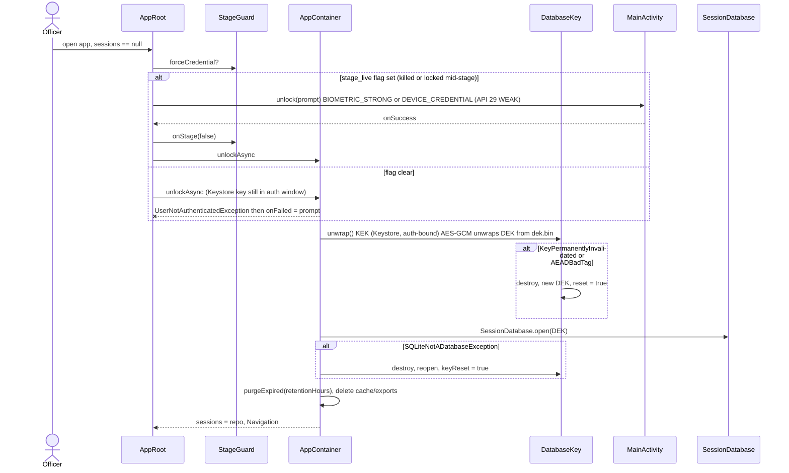
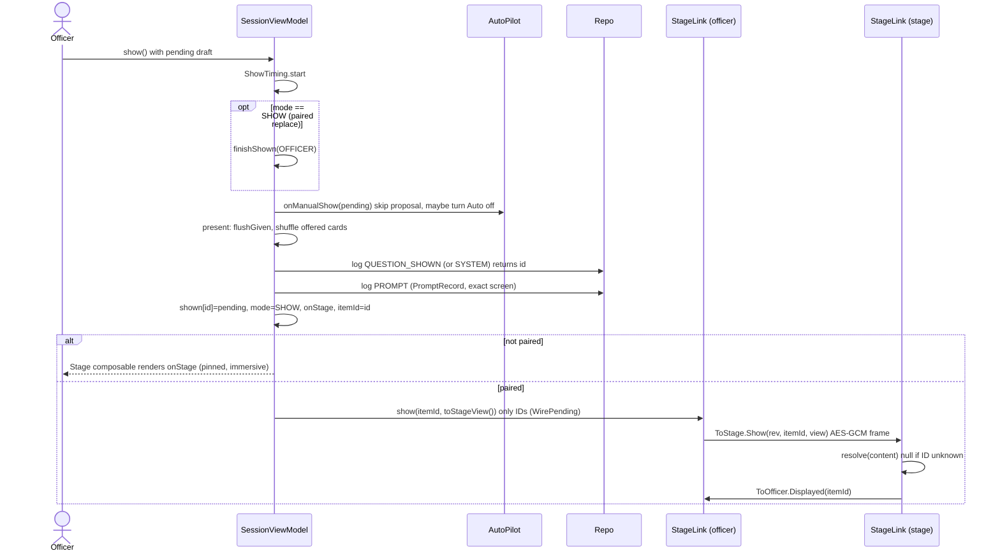
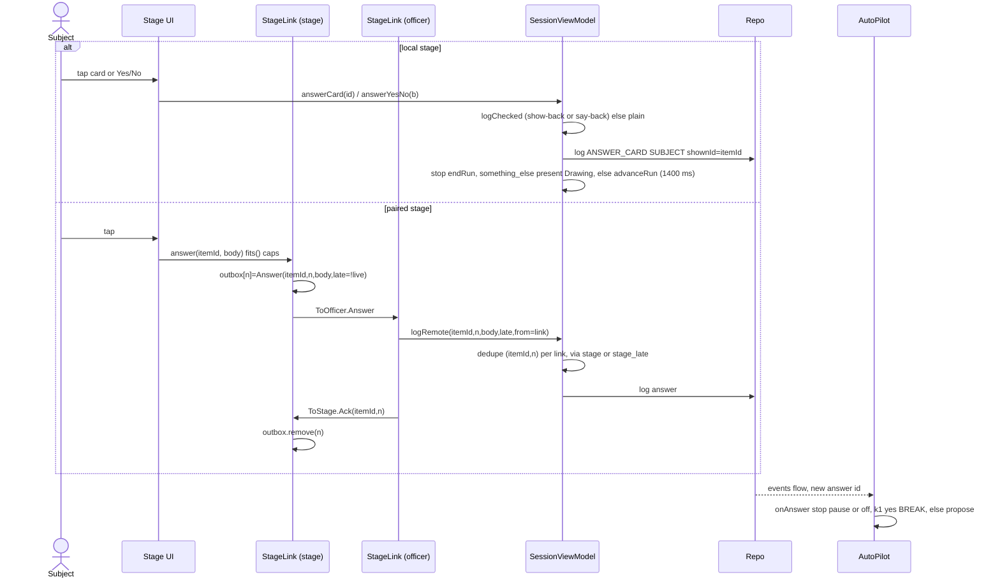
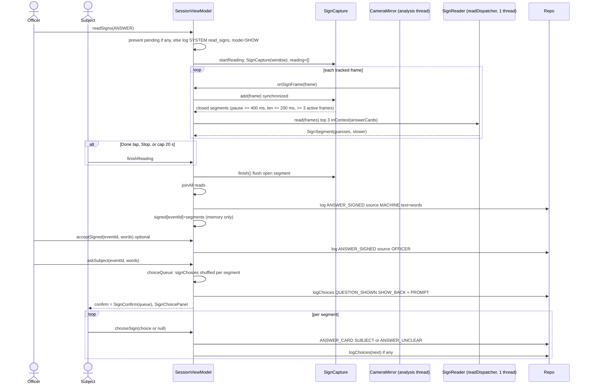
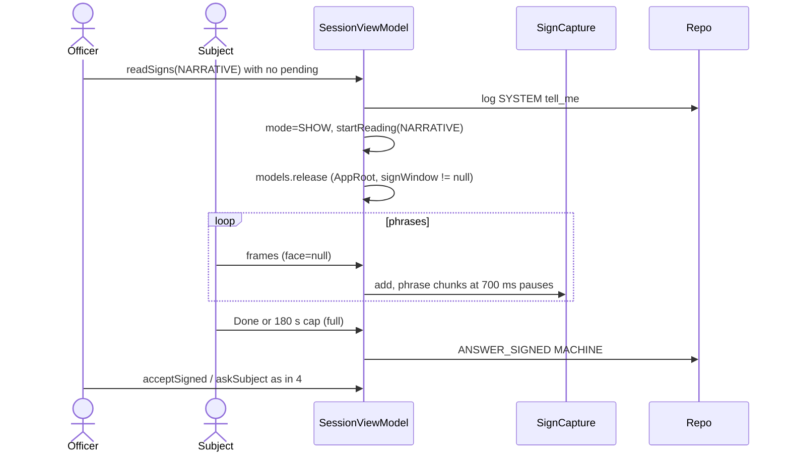
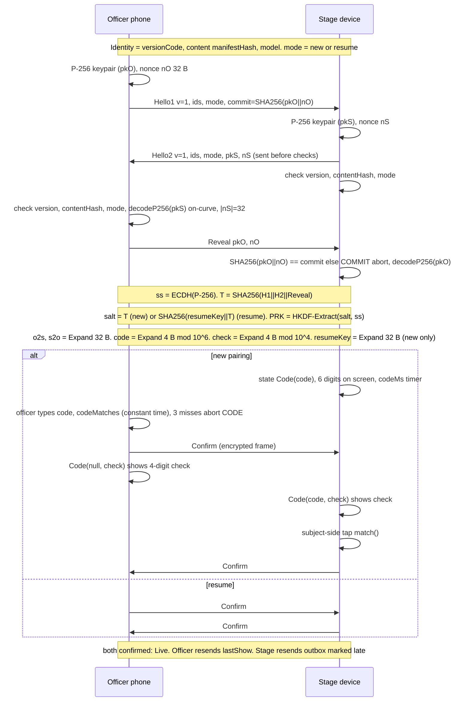
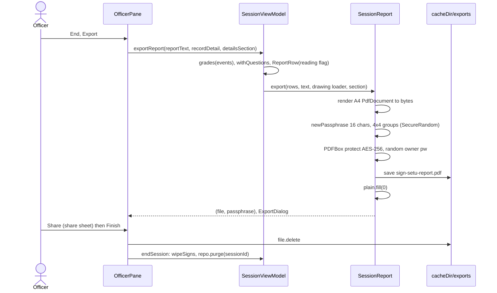

# Sequences

Root: `app/src/main/java/app/signsetu/`. VM = `ui/session/SessionViewModel.kt`, Repo = `SessionRepository` (SQLCipher log).

## 1. Unlock

`ui/AppRoot.kt` (LockScreen branch), `SignSetuApp.kt` (`unlock`, `unlockAsync`), `MainActivity.kt` (`unlock`), `data/session/DatabaseKey.kt`, `ui/session/Handover.kt` (`StageGuard`).

## 2. Show item (local stage and paired stage)

`SessionViewModel.show` / `present`, `AutoPilot.onManualShow`, `pair/StageBridge.kt` (`rememberPairedStage`), `pair/StageWire.kt`.

## 3. Subject answer

Local: `answerCard` / `answerYesNo` / `answerText` / `submitDrawing`. Paired: `StageLink.answer`, `SessionViewModel.logRemote`.

## 4. Sign window read and subject confirm

`SessionViewModel.readSigns` / `startReading` / `onSignFrame` / `finishReading` / `askSubject` / `chooseSign`, `sign/SignCapture.kt`.

## 5. Tell me narrative

Same path as 4 with `SignWindow.NARRATIVE`: limit 180 s, pause 700 ms, faces dropped (`keepFace = false`).

## 6. Pairing handshake

`pair/PairCrypto.kt` (`officerHandshake`, `stageHandshake`, `derive`, `LinkSession`), `pair/StageLink.kt` (`start`, `submitCode`, `match`, `maybeLive`). Transport: Bluetooth RFCOMM (`pair/BluetoothTransport.kt`). Handshake messages are length-prefixed plain JSON, cap 4 KiB.

Frame format (`LinkSession`):

| Field | Size | Note |
|---|---|---|
| len | u32 | 16 .. 1 MiB, else SIZE abort |
| counter | u64 | must equal expected, else PROTOCOL abort (no replay, no gap) |
| ct+tag | len | AES-256-GCM, 128-bit tag |

- IV (12 B) = dir byte (1 officer, 2 stage) `00 00 00` counter(u64). Unique per key.
- AAD (9 B) = `01` counter(u64).
- Max 2^32 frames per direction.
- Heartbeat: Ping every `pingMs`, silent > `lostMs` = fault.

## 7. Export

`OfficerPane.kt` (end dialog), `SessionViewModel.exportReport`, `export/SessionReport.kt`.

