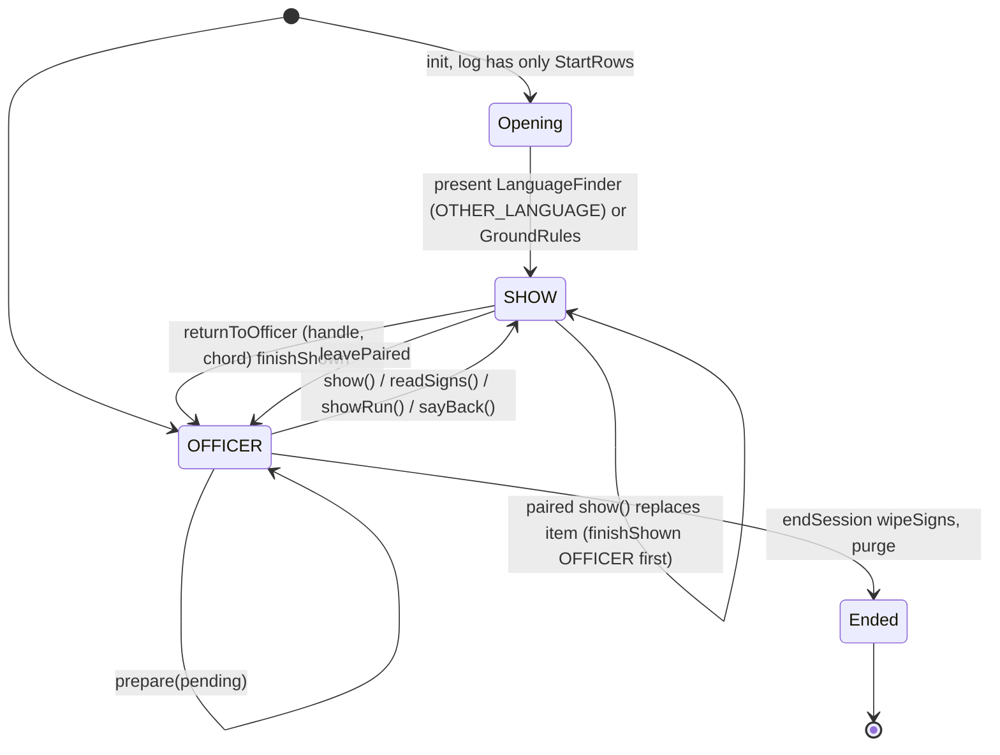
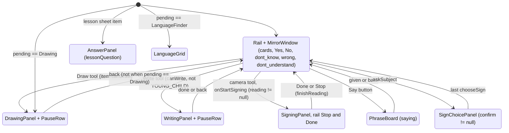
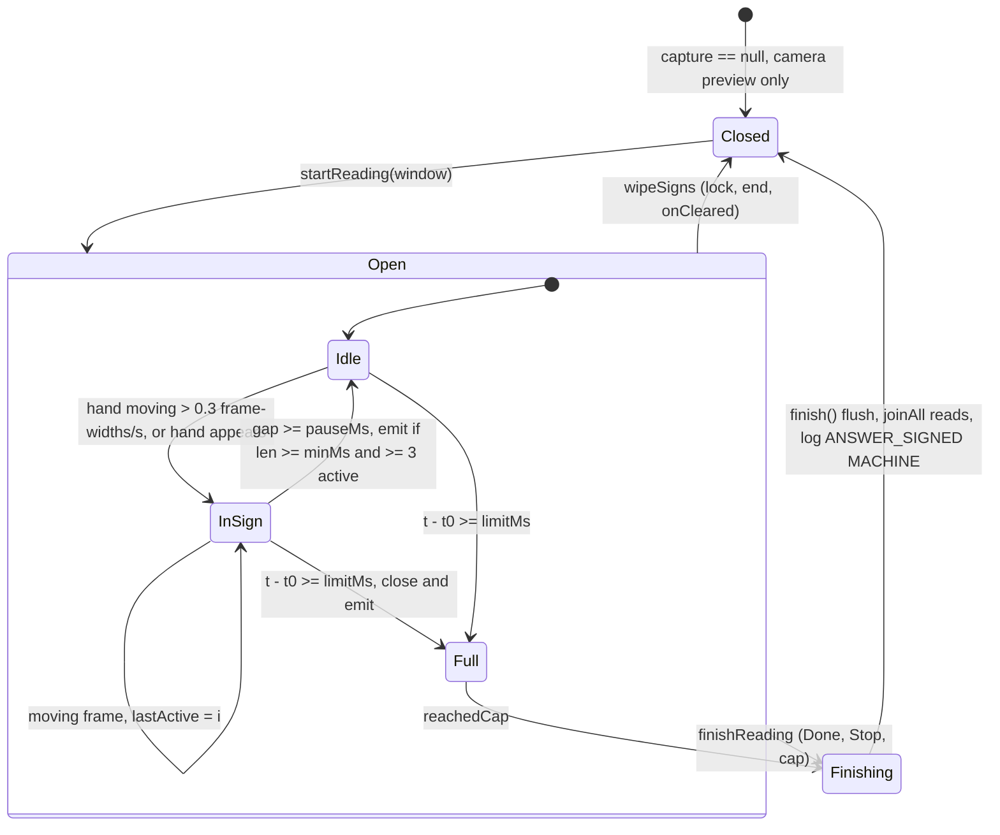
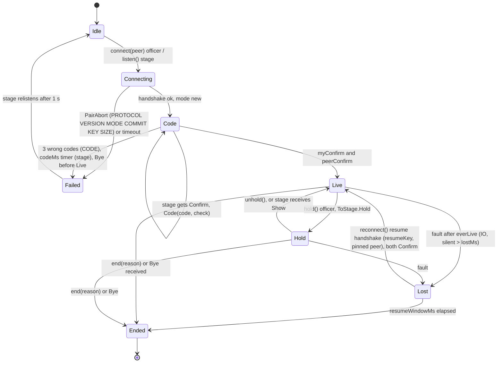
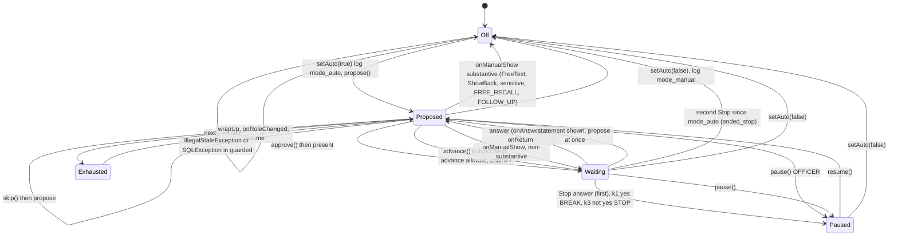
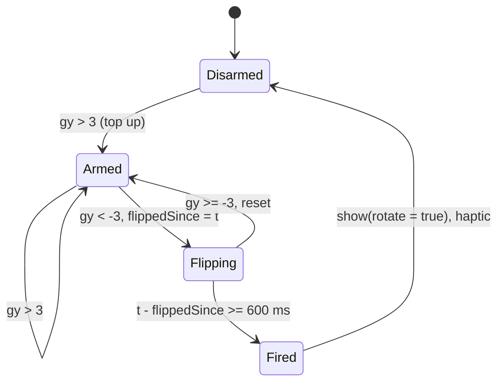
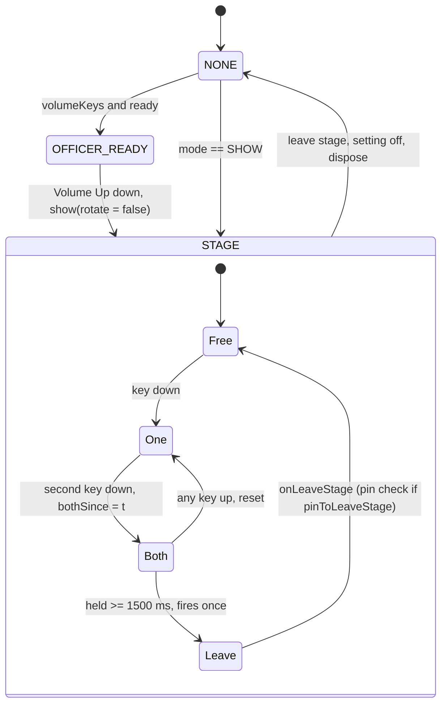

# State machines

Root: `app/src/main/java/app/signsetu/`.

## 1. Session (`ui/session/SessionViewModel.kt`, `Mode`)

`Mode { OFFICER, SHOW }`. `pending` = officer draft, `onStage` = logged item on stage, `itemId` = its row (D-26).

`finishShown`: unanswered show-back or say-back logs ANSWER_UNCLEAR, skipped ground rules log `rules_skipped`, `endRun`, apply `chosenLanguage`, `auto.onReturn()`.

## 2. Stage modes (`ui/session/Stage.kt`, `Stage` composable)

Panel under the avatar, first match wins.

Overlays: `rightsNotice` replaces Yes/No with `dont_understand` only. `PauseCards` answer = paused. `checking` (asksChoice) stops the avatar acting out the officer reading.

## 3. Sign window (`sign/SignCapture.kt`, `SessionViewModel`)

| Window | limitMs | pauseMs | minMs | keepFace |
|---|---|---|---|---|
| ANSWER | 20 000 | 400 | 200 | true |
| NARRATIVE | 180 000 | 700 | 200 | false |

## 4. Pairing link (`pair/StageLink.kt`, `LinkState`)

Stage side relistens 500 ms after Lost. On resume Live: stage resends outbox with `late = true`. Before Live any non-handshake frame = PROTOCOL abort.

## 5. Auto mode (`ui/session/AutoPilot.kt`, `Conv`)

Every transition logs first (SUGGESTED, APPROVED, SKIPPED, AUTO_ADVANCED, SYSTEM keys). Memory only, reopens Off.

`autoAdvance` flag: only while not Off; off on role change.

## 6. Handover (`ui/session/Handover.kt`)

Local stage only (not paired). `ready` = mode OFFICER and pending != null.

### Tilt (`TiltDetector`, gravity y, accelerometer low-passed 0.2)

### Volume keys (`HardKeys`, `KeyMode`, `ChordDetector`)

- OFFICER_READY consumes Up only. STAGE consumes both keys. NONE leaves keys to the system. TalkBack on: keys never consumed (`MainActivity`).
- `StageGuard.onStage(live)` writes `stage_live` with `commit()` before the subject holds the phone, forcing full credential on next unlock.
